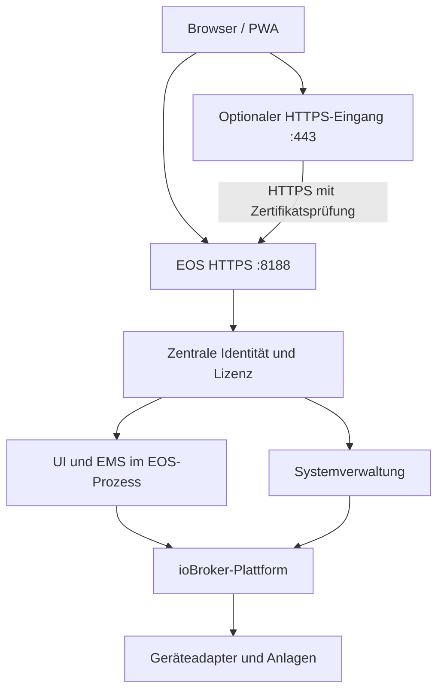

# Architektur der Zusammenführung

**NexoWatt EOS · 9.0.5 · EOS-MERGE-001**

## Ein Paket und eine Instanz

`iobroker.eos-admin` bleibt die technische Paketidentität; der sichtbare Name ist
NexoWatt EOS. Es gibt einen ioBroker-Lifecycle und eine Verbindung der Instanz
`eos-admin.<Instanz>` zum Controller. UI-/EMS-Funktionen werden intern über eine
begrenzte Adapterfassade angebunden. Eine zweite gleichnamige Adapterinstanz oder
ein parallel laufender `nexowatt-ui`-Adapter ist nicht Bestandteil des Zielbetriebs.

Der UI-Bestand liegt unter `ui/`; die zugehörige Konfiguration liegt in
`native.eosUi`. Der interne Zugriff übersetzt diese Konfiguration für die
übernommenen Module. Bestehende Datenpunktreferenzen müssen bei einer Migration
geprüft werden; ein Paketname allein migriert keine Kundenobjekte.

## Abweichung vom langfristigen Plan

Version 9.0.5 hostet UI/EMS und Verwaltung **im selben Prozess**.
Sie führt noch keine getrennte EMS-Worker-Laufzeit ein. Ein Browser-Reload startet
nicht den Adapter neu; ein Adapterstopp, Absturz oder Controllerneustart kann die
Regelung unterbrechen. Auch umfangreiche Verwaltungsarbeit kann den gemeinsamen
Event-Loop belasten. Die Ziele 50 ms für Lastmanagement und 100 ms für weitere
Regelaufgaben sind zu messende Anforderungen, keine in diesem Stand nachgewiesenen
Garantien. Last-, Wiederanlauf- und Hardwaretests bleiben erforderlich.

## Webbereitschaft und operativer Start – EOS-WEBSTART-001

Der 9.0.2-Startpfad wartete vor der Listenerbindung auf die vollständige operative
UI-/EMS-Initialisierung. Ein unbeantworteter History-Callback konnte den Ablauf
festhalten, obwohl Lizenzprüfung und Teile des EMS bereits gestartet waren.
`LICENSE_VALID` und `engineStarted` sind deshalb keine Nachweise eines erreichbaren
HTTPS-Endpunkts.

9.0.3 trennt die Einrichtung der geschützten Weboberfläche vom operativen Start:
Der HTTPS-Listener wartet nicht auf die vollständige EMS-Initialisierung. Deren
Startzustand und Fehler werden gesondert behandelt; die Oberfläche darf eine
teilweise initialisierte Regelung nicht als betriebsbereit ausgeben. Lizenz,
Benutzerrechte und Schreibzuständigkeit werden dadurch nicht umgangen.
`EOS_HTTPS_READY` folgt auf erfolgreiche Listenerbindung und Einrichtung der
gemeinsamen Webauthentisierung. `info.connection` wird an dieser Stelle gesetzt;
dieser Webstatus ist keine Bestätigung des vollständigen operativen EMS-Starts.
Ein nachfolgender Startfehler darf den bereits gebundenen Listener nicht durch
eine ungeschützte Ersatzoberfläche ersetzen. Stop/Restart und verspätete
Startabschlüsse bleiben Gegenstand gezielter Lifecycleprüfungen.

Die Instanz-/Übersichtskachel der aktuell verbundenen EOS-Instanz übernimmt bei
ihrem Standardlink die tatsächlich verwendete HTTPS-Browser-Origin und führt auf
`/`. Eine funktionierende Verbindung über 8188 oder einen 443-Alias wird nicht durch
alte gespeicherte Bind-/Portwerte ersetzt. Andere Instanzen, Drittadapter und
benutzerdefinierte URLs bleiben unverändert; dies ist keine automatische
Netzwerk- oder Proxykonfiguration.

## Socket-Ereignislast und gemeinsame Abonnements – EOS-SOCKET-001

9.0.3 konnte beim Start ohne Browser abstürzen: Die zentrale Laufzeit leitete
State-Ereignisse auch an die Socket-Verwaltung weiter. Nach drei Intervallen
oberhalb der Ereignisgrenze griff deren asynchroner Umschalttimer auf
`subscribes.stateChange` zu, obwohl noch kein Browser diese Liste angelegt hatte.
Der erste Zugriff auf `Object.keys(undefined)` beendete den gemeinsamen Prozess.

Für 9.0.4 gelten folgende Grenzen: Ein leerer Browser-Abonnementbestand ist ein
regulärer Zustand. Die Begrenzung ausgehender Oberflächenereignisse bleibt aktiv.
Browser-Abmeldung, Wechsel in die Begrenzung und anschließende Wiederaufnahme
verwalten nur den Bedarf der Socket-Oberfläche; sie dürfen keine von der
EMS-Laufzeit benötigten Messwert-Abonnements entfernen. Timer und nachlaufende
Aufträge müssen beim Entladen beendet werden. Authentisierung, Rollen und
Objektberechtigungen bleiben für Socket-Befehle verbindlich.

Diese Trennung betrifft Abonnementzuständigkeit im gemeinsamen Prozess. Sie ist
keine Prozessisolation und kein Nachweis harter Regellatenzen. Vorher-/Nachher-
Reproduktion, Lastwechsel und Neustart werden im 9.0.4-Prüfbericht getrennt von
der noch nötigen Geräteabnahme ausgewiesen.

## HTTP-Übergabe an die eingebettete UI – EOS-HTTP-QUERY-001

Der äußere Verwaltungsserver verwendet Express 5; die bestehende operative UI
verwendet Express 4. Beide bearbeiten im Hosted-Betrieb dasselbe Request-Objekt.
Express 5 stellt `query` über einen Getter des Request-Prototyps bereit. Die
Express-4-Initialisierung darf diesen Wert nicht dadurch verlieren, dass sie den
Prototyp ersetzt. Ein bloßer Test der UI auf ihrem eigenen Express-4-Server deckt
diesen Übergang nicht ab.

9.0.5 bewahrt Query-Daten an der gemeinsamen Grenze. Die History-Routen müssen
fehlende, mehrfach angegebene, verschachtelte oder ungültige Parameter kontrolliert
behandeln. Eine asynchrone Routenexception darf keine unbehandelte Promise-Ablehnung
und keinen Adapterneustart auslösen. Die Fehlerbehandlung ist lokal zur HTTP-Route;
sie ist kein globaler `uncaughtException`-Handler, der einen beschädigten Prozess
weiterlaufen lässt. Authentisierung, Rollen-, Lizenz- und Objektprüfungen gelten
unverändert vor dem operativen Zugriff.

Der Feldfehler in 9.0.4 endet beim Zugriff auf `req.query.from`, bevor History-Daten
angefordert werden. Die weitere Validierung von History-Antworten ist deshalb eine
zusätzliche Stabilitätsmaßnahme und wird getrennt vom ursprünglichen Befund geprüft.
Späte Abmeldungen nach bereits geschlossenem Abonnementmanager sind beim Stop ein
idempotenter Aufräumvorgang; neue Anmeldungen dürfen ihn nicht wieder öffnen.

## History-Anfragen und Ressourcen – HISTORY-905-02

History-Antworten sind externe Daten. Ungültige Einträge einschließlich `null`,
fehlender Zeitstempel und nicht endlicher Werte werden kontrolliert behandelt.
Die API erhält ein gemeinsames monotones Budget von **5.000 ms** über zugehörige
Reads und Fallbacks. Abbruch, Shutdown und verspätete/mehrfache Antworten dürfen
weder eine neue Antwort noch eine nachträgliche Mutation auslösen.

| Grenze | Verhalten |
| --- | --- |
| Rohantwort | Höchstens 10.000 Zeilen; ungültige/zu große Antworten kontrolliert ablehnen. |
| Zeitraster | Höchstens 4.096 Punkte; größere Abfrage als HTTP 400 `EOS_HISTORY_RANGE_INVALID` ablehnen. |
| Parallele Berechnungen | Höchstens 4 verschiedene Berechnungen; bei Überlast HTTP 503 `EOS_HISTORY_BUSY`. |
| Antwortcache | Höchstens 4 Payloads, Gültigkeit 5 Sekunden. |
| Jahresbericht | Höchstens 2 parallele Worker; bestehender Umfang bis 10 Jahre bleibt unterstützt. |
| Fehler | `EOS_HISTORY_TIMEOUT`, `EOS_HISTORY_CANCELLED`, `EOS_HISTORY_UNAVAILABLE`, `EOS_HISTORY_RESPONSE_INVALID`; keine privaten Transportdetails oder ungeprüften Fehlerobjekte. |

Die Limits ersetzen keine Geräte-/Dauerlastmessung. Die positiven und negativen
Tests sowie tatsächliche Controller-/Browserabläufe stehen im versionsgebundenen
Bericht. Ein begrenzter Fehler ist im Frontend als fehlende Auswertung zu behandeln,
nicht als erfolgreich ermittelter Nullverbrauch.

## Startanzeige und Speicherbedarf

Die EOS-Systemverwaltung unter `/system/` verwendet für Bootstrap- und Ladeanzeige
NexoWatt-Assets. Die Drittanbieter-Lizenzhinweise und der eigenständige ioBroker-Admin
auf seinem bisherigen Port werden dadurch nicht geändert. Der erste HTML-Inhalt und
die spätere React-Ladeanzeige müssen beide im Browser geprüft werden.

Die vom Nutzer beobachteten rund 750 MB sind keine in der Entwicklungsumgebung
reproduzierte Messung. Speichermessungen müssen RSS, Heap, externe Puffer, aktive
Anfragen, Datenmenge und Messzeitraum unterscheiden. Ein sinkender synthetischer
Cacheverbrauch beweist keine entsprechende Gesamtersparnis auf der Anlage.
Die EMS-Datenpunktregistry hält nur explizit benötigte Quell-, Alias- und
Verbindungsreferenzen vor. Heartbeat-Verwandtschaft verwendet erforderliche
Zeitstempel ohne den fremden Payload. Konfigurationswechsel müssen Referenzen und
entfernte Cachewerte konsistent aktualisieren; das Einschränken dieses Caches darf
keine benötigten Controller-Abonnements entfernen. Synthetische Vorher-/Nachher-
Messungen und verbleibende Grenzen stehen im 9.0.5-Prüfbericht.

## History und MultiUse beim Start

**HISTORY-001:** `_nwGetHistoryAvgSeries` erhält höchstens 5 Sekunden;
`_nwGetHistoryAvgSeriesAny` teilt ein einziges monotones 5-Sekunden-Gesamtbudget
über alle Fallback-Kandidaten. Auch ohne Callback endet der Vorgang mit
`EOS_HISTORY_TIMEOUT`; nach verbrauchtem Budget startet keine weitere
Fallbackrunde. Verspätete oder mehrfache Callbacks werden ignoriert, offene
Anfragen beim Shutdown beendet. Es entsteht kein neuer Retry-/Cachedienst;
das bestehende Stundenintervall bleibt bestehen.

Die Energieauswertung behält bei leeren, ungültigen oder fehlgeschlagenen
History-Zweigen bisherige gültige Werte und deren Zeitpunkte bei. Sie erzeugt
daraus keine frisch datierten CO₂-Werte. Echte gültige Nullleistungsproben bleiben
zulässig. Konkrete Fehlerfälle sind im [Prüfplan](COMMISSIONING.md) zugeordnet;
Datenqualität und Webbereitschaft sind getrennte Zustände.

**MULTIUSE-001:** Die lokale Initialisierung legt auch bei `enableMultiUse: false`
die Objekte `multiUse.control.active`, `multiUse.control.requestW`,
`multiUse.control.budgetW` und `multiUse.control.status` an. Erst danach darf die
Deaktivierung diese Zustände schreiben. Das beendet die bisher mögliche Folge
„Statusschreiben ohne Objekt“; das Modul bleibt deaktiviert, operative Ticks
bleiben an seine Aktivierung gebunden. Gerätekommandos, Lizenz-/Safetygrenzen und
bestehende Konfiguration werden dadurch nicht freigegeben oder zurückgesetzt.

## Integrationsstellen und Webpfade

`src/lib/eosUnifiedBoundary.js` bildet die gemeinsame Web-/Transportgrenze;
`src/lib/eosUnifiedOwnership.js` begrenzt die Schreibzuständigkeit. Der zentrale
Lizenzdienst liegt weiterhin in `src/lib/eosLicenseCore.js`,
`eosLicensePolicy.js`, `eosLicenseService.js`, `eosLicenseTrust.js` und `eosLicenseHttp.js`.
Diese Dateien sind Integrationsbezüge, kein eigener Nachweis ihres fehlerfreien Betriebs.

| Pfad | Zweck |
| --- | --- |
| `/`, `/login.html` | Dashboard beziehungsweise zentrale sichtbare Anmeldung. |
| `/installer/` | Inbetriebnahme und Gerätezuordnung nach Rolle. |
| `/system/` | Geschützte EOS-/ioBroker-Systemverwaltung. |
| `/api/auth/status`, `/api/auth/login`, `/api/auth/logout` | Gemeinsamer Sitzungsvertrag. |
| `/nexowatt/license` | Zentraler Lizenzbereich und zugehörige bestehende Unterrouten. |

Im neuen HTTPS-Profil bleibt `eosExternalOrigin` **leer**, sowohl direkt auf 8188
als auch mit optionalem 443-Eingang und geprüftem HTTPS-Upstream. So bleiben die
vorgesehenen IP-/Namenszugänge parallel möglich; ein fest eingetragener
Einzel-Origin würde andere Zugänge absichtlich ausschließen. Host-/Originprüfung
wird dadurch nicht abgeschaltet. Nur das ausdrücklich ausgewählte ältere
HTTP-Loopback-Profil verlangt eine exakte externe HTTPS-Origin; es ist kein
Fehlerfallback für dieses HTTPS-Profil. Deep Links, WebSocket und SSE sind je
verwendetem Profil im neuen Integrationsnachweis zu prüfen.

## Gemeinsame Sicherheitsautorität

| Bereich | Vertrag |
| --- | --- |
| Benutzerquelle | Bestehende ioBroker-Benutzer und Gruppen; keine zusätzliche Passwortdatenbank der UI. |
| Anmeldung | Gemeinsame OAuth-Authentifizierung und Erstpasswortwechsel. Kein TOTP-Challenge-/Passkey-Flow; konfigurierte TOTP-/fehlerhafte externe Authentisierung wird gesperrt. |
| Browserrechte | Vom zentralen Server bezogen; versteckte Menüpunkte ersetzen keine serverseitige Autorisierung. |
| HTTP/Socket/Livewerte | Gleiche Identität; jede Aktion, Objektfreigabe und laufende Verbindung berücksichtigt Widerruf. |
| Lizenz | Ein zentraler Dienst; integrierte UI erhält geprüfte Freigaben, keinen eigenen Keygen oder Parallelverifier. |
| Schreibzuständigkeit | Genau eine freigegebene EMS-Laufzeit darf Stellwerte ausgeben; Eigentumsübergabe gehört zur Migration. |
| Dienstkonto | Regulärer Adapterbetrieb ohne Root; keine Selbstprivilegierung durch Webaufrufe. |

Der Login dieses Teststands unterstützt kein TOTP-Challenge-Verfahren und keine Passkeys.
`common.externalAuthentication.totp`, sofern weder fehlend noch `null`, sowie ein
fehlerhaftes `externalAuthentication` sperren den Zugang sicher, statt eine vorhandene
MFA-Anforderung mit dem Passwort zu umgehen. Aktivierung dieser Konfiguration
widerruft bestehende Sitzungen. Der Erstpasswortwechsel bleibt unterstützt.

Der zentrale Logout erhöht die **globale** Sitzungsgeneration. Alle parallelen
Nutzer einschließlich offener Socket-/SSE-Verbindungen werden damit abgemeldet;
Abmeldung nur einer einzelnen Sitzung ist eine noch offene Verbesserung.

Die vorhandenen Objekt-ACLs bleiben eine zusätzliche Grenze. Ein berechtigter
Installer erhält nicht allein durch den Menüpunkt Systemverwaltungsrechte. Die
endgültige Befehls-/Routenmatrix und tatsächlich ausgeführte Tests sind dem
Abschlussbericht zu entnehmen.

## Direkter HTTPS-Zugang und optionaler Eingang

Das Standardprofil von 9.0.5 ist **HTTPS auf `0.0.0.0:8188` mit Authentisierung**.
`0.0.0.0` bedeutet Bindung an die IPv4-Schnittstellen; es ist keine vom Browser
aufzurufende Adresse. Nutzer öffnen `https://<Geräte-IP>:8188/`. Die native
Konfiguration setzt `secure: true`, `auth: true`, `certPublic: defaultPublic`,
`certPrivate: defaultPrivate` und eine leere `eosExternalOrigin`.
Zertifikatsnamen sind Verweise auf vorhandenes ioBroker-Zertifikatsmaterial, keine
mitgelieferten privaten Schlüssel und keine Garantie einer passenden SAN oder
bereits hergestellten Client-Vertrauensstellung. Das normale erste Controller-Setup
erzeugt die Standardzertifikate; beim untersuchten Controller 7.2.5 enthält deren
SAN den Betriebssystem-Hostnamen, nicht automatisch zusätzliche Geräte-IP-/EOS-Namen.

Der Gerätehostname `NexoWattEOS` benötigt lokale Namensauflösung. Bei DNS-Zugriff
muss der Name als DNS-SAN, bei IP-Zugriff die Adresse als IP-SAN zum Zertifikat
passen. Ausstellervertrauen, individuelle Schlüssel und Erneuerung gehören zur
Einrichtung. Weder der Paketname noch der sichtbare Titel richten DNS ein.

Optional kann Nginx Port 443 übernehmen. Dessen Upstream bleibt **HTTPS**; CA und
Upstream-Name werden überprüft. Das ausgewählte Zertifikat muss zum geprüften
Namen beziehungsweise zur geprüften IP passen. Kein `proxy_ssl_verify off`,
kein HTTP-Upstream und kein automatisches Raten des Transports. Die konkrete
Konfiguration steht in [deploy/README.md](../../deploy/README.md).

Das npm-Paket setzt keine Hostdienste, Firewall oder DNS-Konfiguration um. Der
Adapter bleibt unprivilegiert; keine pauschale Portbindefähigkeit auf dem gemeinsam
verwendeten Node-Interpreter. Für den optionalen Port-443-Eingang ist ein separat
begrenzter Systemdienst erforderlich. Sein Konfigurationsprofil, Bindung und
Netzerreichbarkeit werden bewusst auf dem Gerät eingerichtet.

Forwarding- oder Hostheader erteilen keine Identität. Direkte Zugriffe und optionale
Proxyzugriffe benötigen dieselben Sitzungs-, Rechte- und Lizenzprüfungen. Das
lokale Betriebssystemkonto bleibt eine gemeinsame Vertrauenszone. Ungültiges TLS
führt zu einer Diagnose, nicht zu einem ungeschützten Ersatzlogin. WebSocket/SSE,
Größenlimits und PWA-Cachegrenzen bleiben Teil des Prüfplans.

## Erhalt des bestehenden Adminzugangs

Die frühere automatische Legacy-Sperre ist außer Betrieb. Gespeicherte
`eosLockLegacyAdmin`-/Legacy-Lock-Einstellungen dürfen `admin.0` nicht wegen der
EOS-Zusammenführung deaktivieren oder dessen Port/Bindung ändern. Der vorhandene
Adminzugang, üblicherweise 8081, bleibt in seinem bisherigen Profil. Seine
Authentisierung und TLS-Einstellungen werden nicht still überschrieben.
Wiederherstellung und Grenzen:
[ACCESS_RECOVERY_9.0.1.md](ACCESS_RECOVERY_9.0.1.md).

## Daten und Grenzen

Lokale Konten, Gerätekennungen, IP-Adressen, Lizenzmetadaten sowie Energie- und
Ladeverläufe können personenbezogene Daten sein. Diagnose enthält keine Passwörter,
Tokens oder vollständigen Lizenzcodes. Backups können Geheimnisse enthalten und
benötigen gesonderte Schutz-/Wiederherstellungsverfahren.

Externe Preis-/Wetterabrufe und optionale Geräteprotokolle bleiben eigene
Vertrauensgrenzen. Ein gemeinsames Webpaket macht Modbus, OCPP oder EEBUS nicht
pauschal verschlüsselt oder IEC-62351-konform. Unabhängige elektrotechnische
Schutzfunktionen dürfen nicht durch EOS-Web-/Lizenzlogik ersetzt werden.
