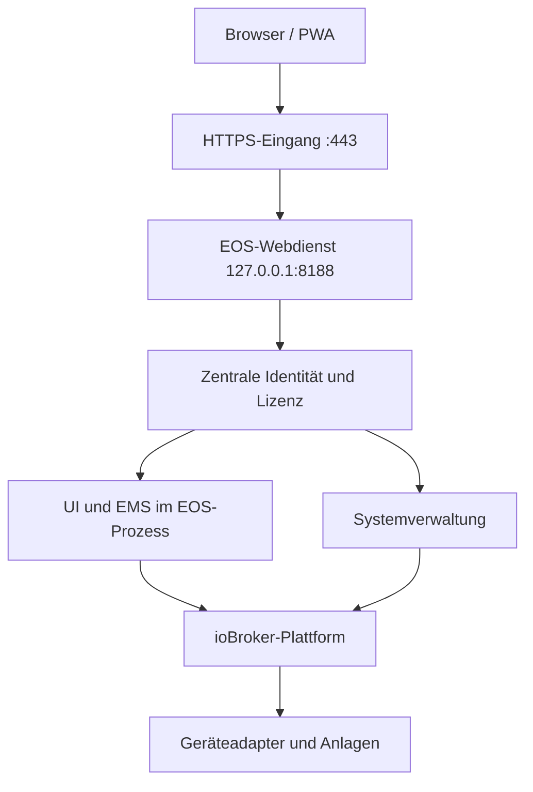

# Architektur der Zusammenführung

**NexoWatt EOS · 9.0.0-alpha.1 · EOS-MERGE-001**

## Ein Paket und eine Instanz

`iobroker.eos-admin` bleibt die technische Paketidentität; der sichtbare Name ist
NexoWatt EOS. Es gibt einen ioBroker-Lifecycle und eine Verbindung der Instanz
`eos-admin.<Instanz>` zum Controller. UI-/EMS-Funktionen werden intern über eine
begrenzte Adapterfassade angebunden. Eine zweite gleichnamige Adapterinstanz oder
ein parallel laufender `nexowatt-ui`-Adapter ist nicht Bestandteil des Zielbetriebs.

Der UI-Bestand liegt unter `ui/`; die zugehörige Konfiguration liegt in
`native.eosUi`. Der interne Zugriff übersetzt diese Konfiguration für die
übernommenen Module. Bestehende Datenpunktreferenzen müssen bei einer Migration
geprüft werden; ein Paketname allein migriert keine Kundenobjekte.

## Abweichung vom langfristigen Plan

Die erste gemeinsame Version hostet UI/EMS und Verwaltung **im selben Prozess**.
Sie führt noch keine getrennte EMS-Worker-Laufzeit ein. Ein Browser-Reload startet
nicht den Adapter neu; ein Adapterstopp, Absturz oder Controllerneustart kann die
Regelung unterbrechen. Auch umfangreiche Verwaltungsarbeit kann den gemeinsamen
Event-Loop belasten. Die Ziele 50 ms für Lastmanagement und 100 ms für weitere
Regelaufgaben sind zu messende Anforderungen, keine in diesem Stand nachgewiesenen
Garantien. Last-, Wiederanlauf- und Hardwaretests bleiben erforderlich.

## Integrationsstellen und Webpfade

`src/lib/eosUnifiedBoundary.js` bildet die gemeinsame Web-/Transportgrenze;
`src/lib/eosUnifiedOwnership.js` begrenzt die Schreibzuständigkeit. Der zentrale
Lizenzdienst liegt weiterhin in `src/lib/eosLicenseCore.js`,
`eosLicensePolicy.js`, `eosLicenseService.js` und `eosLicenseHttp.js`.
Diese Dateien sind Integrationsbezüge, kein eigener Nachweis ihres fehlerfreien Betriebs.

| Pfad | Zweck |
| --- | --- |
| `/`, `/login.html` | Dashboard beziehungsweise zentrale sichtbare Anmeldung. |
| `/installer/` | Inbetriebnahme und Gerätezuordnung nach Rolle. |
| `/system/` | Geschützte EOS-/ioBroker-Systemverwaltung. |
| `/api/auth/status`, `/api/auth/login`, `/api/auth/logout` | Gemeinsamer Sitzungsvertrag. |
| `/nexowatt/license` | Zentraler Lizenzbereich und zugehörige bestehende Unterrouten. |

`eosExternalOrigin` enthält die exakte öffentliche HTTPS-Origin ohne Pfad, z. B.
`https://192.168.1.10`. Das konkrete Routenverhalten einschließlich Deep Links,
WebSocket und SSE wird im Integrationsnachweis geprüft.

## Gemeinsame Sicherheitsautorität

| Bereich | Vertrag |
| --- | --- |
| Benutzerquelle | Bestehende ioBroker-Benutzer und Gruppen; keine zusätzliche Passwortdatenbank der UI. |
| Anmeldung | Gemeinsame OAuth-Authentifizierung und Erstpasswortwechsel. Kein TOTP-Challenge-/Passkey-Flow; konfigurierte TOTP-/fehlerhafte externe Authentisierung wird gesperrt. |
| Browserrechte | Vom zentralen Server bezogen; versteckte Menüpunkte ersetzen keine serverseitige Autorisierung. |
| HTTP/Socket/Livewerte | Gleiche Identität; jede Aktion, Objektfreigabe und laufende Verbindung berücksichtigt Widerruf. |
| Lizenz | Ein zentraler Dienst; integrierte UI erhält geprüfte Freigaben, keinen eigenen Keygen oder Parallelverifier. |
| Schreibzuständigkeit | Genau eine freigegebene EMS-Laufzeit darf Stellwerte ausgeben; Eigentumsübergabe gehört zur Migration. |
| Dienstkonto | Regulärer Adapterbetrieb ohne Root; keine Selbstprivilegierung durch Webaufrufe. |

Der Alpha-Login unterstützt kein TOTP-Challenge-Verfahren und keine Passkeys.
`common.externalAuthentication.totp`, sofern weder fehlend noch `null`, sowie ein
fehlerhaftes `externalAuthentication` sperren den Zugang sicher, statt eine vorhandene
MFA-Anforderung mit dem Passwort zu umgehen. Aktivierung dieser Konfiguration
widerruft bestehende Sitzungen. Der Erstpasswortwechsel bleibt unterstützt.

Der zentrale Logout erhöht die **globale** Sitzungsgeneration. Alle parallelen
Nutzer einschließlich offener Socket-/SSE-Verbindungen werden damit abgemeldet;
Abmeldung nur einer einzelnen Sitzung ist eine noch offene Verbesserung.

Die vorhandenen Objekt-ACLs bleiben eine zusätzliche Grenze. Ein berechtigter
Installer erhält nicht allein durch den Menüpunkt Systemverwaltungsrechte. Die
endgültige Befehls-/Routenmatrix und tatsächlich ausgeführte Tests sind dem
Abschlussbericht zu entnehmen.

## HTTPS und lokale Vertrauensgrenze

Außen wird `https://<Geräte-IP>/` verwendet, innen `127.0.0.1:8188`. Ein fester
HTTPS-Eingang wird durch die Systeminstallation eingerichtet. Das npm-Paket allein
richtet Port 443, Zertifikate, Firewall und Dienstrechte nicht automatisch ein.

Die öffentliche HTTPS-Origin ist explizit konfiguriert. Host-/Forwarding-Header aus
einem Browser erteilen keine Identität und dürfen keine beliebige Origin zulassen.
Ein prüfbarer Nginx-Eingang und die Grenzen der Offline-Migrationsplanung stehen
in [deploy/README.md](../../deploy/README.md). Auch direkte Loopback-Aufrufe benötigen die regulären Sitzungs-, Rechte- und
Lizenzprüfungen. Loopback ist keine Isolation gegenüber anderen lokalen Prozessen.

Der TLS-Schlüssel ist gerätebezogen, außerhalb des Repositorys geschützt abzulegen.
Das Zertifikat benötigt die tatsächliche Geräte-IP als IP-SAN; die ausstellende CA
muss auf den Clients vertraut sein. Ungültiges TLS führt zu einer Diagnose und nicht
zu einem ungeschützten Ersatzlogin. Für WebSocket, SSE, Uploads und Downloads gelten
passende Größen-/Zeitlimits. Der Service Worker darf keinen geschützten Admin-/API-
Inhalt als offline angemeldete Sitzung ausgeben.

## Daten und Grenzen

Lokale Konten, Gerätekennungen, IP-Adressen, Lizenzmetadaten sowie Energie- und
Ladeverläufe können personenbezogene Daten sein. Diagnose enthält keine Passwörter,
Tokens oder vollständigen Lizenzcodes. Backups können Geheimnisse enthalten und
benötigen gesonderte Schutz-/Wiederherstellungsverfahren.

Externe Preis-/Wetterabrufe und optionale Geräteprotokolle bleiben eigene
Vertrauensgrenzen. Ein gemeinsames Webpaket macht Modbus, OCPP oder EEBUS nicht
pauschal verschlüsselt oder IEC-62351-konform. Unabhängige elektrotechnische
Schutzfunktionen dürfen nicht durch EOS-Web-/Lizenzlogik ersetzt werden.
