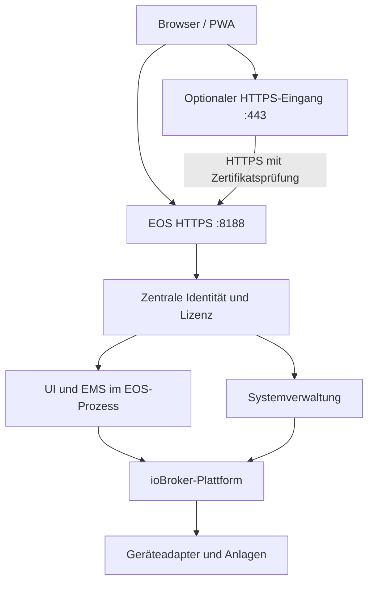

# Architektur der Zusammenführung

**NexoWatt EOS · 9.0.1 · EOS-MERGE-001**

## Ein Paket und eine Instanz

`iobroker.eos-admin` bleibt die technische Paketidentität; der sichtbare Name ist
NexoWatt EOS. Es gibt einen ioBroker-Lifecycle und eine Verbindung der Instanz
`eos-admin.<Instanz>` zum Controller. UI-/EMS-Funktionen werden intern über eine
begrenzte Adapterfassade angebunden. Eine zweite gleichnamige Adapterinstanz oder
ein parallel laufender `nexowatt-ui`-Adapter ist nicht Bestandteil des Zielbetriebs.

Der UI-Bestand liegt unter `ui/`; die zugehörige Konfiguration liegt in
`native.eosUi`. Der interne Zugriff übersetzt diese Konfiguration für die
übernommenen Module. Bestehende Datenpunktreferenzen müssen bei einer Migration
geprüft werden; ein Paketname allein migriert keine Kundenobjekte.

## Abweichung vom langfristigen Plan

Version 9.0.1 hostet UI/EMS und Verwaltung **im selben Prozess**.
Sie führt noch keine getrennte EMS-Worker-Laufzeit ein. Ein Browser-Reload startet
nicht den Adapter neu; ein Adapterstopp, Absturz oder Controllerneustart kann die
Regelung unterbrechen. Auch umfangreiche Verwaltungsarbeit kann den gemeinsamen
Event-Loop belasten. Die Ziele 50 ms für Lastmanagement und 100 ms für weitere
Regelaufgaben sind zu messende Anforderungen, keine in diesem Stand nachgewiesenen
Garantien. Last-, Wiederanlauf- und Hardwaretests bleiben erforderlich.

## Integrationsstellen und Webpfade

`src/lib/eosUnifiedBoundary.js` bildet die gemeinsame Web-/Transportgrenze;
`src/lib/eosUnifiedOwnership.js` begrenzt die Schreibzuständigkeit. Der zentrale
Lizenzdienst liegt weiterhin in `src/lib/eosLicenseCore.js`,
`eosLicensePolicy.js`, `eosLicenseService.js` und `eosLicenseHttp.js`.
Diese Dateien sind Integrationsbezüge, kein eigener Nachweis ihres fehlerfreien Betriebs.

| Pfad | Zweck |
| --- | --- |
| `/`, `/login.html` | Dashboard beziehungsweise zentrale sichtbare Anmeldung. |
| `/installer/` | Inbetriebnahme und Gerätezuordnung nach Rolle. |
| `/system/` | Geschützte EOS-/ioBroker-Systemverwaltung. |
| `/api/auth/status`, `/api/auth/login`, `/api/auth/logout` | Gemeinsamer Sitzungsvertrag. |
| `/nexowatt/license` | Zentraler Lizenzbereich und zugehörige bestehende Unterrouten. |

Im neuen HTTPS-Profil bleibt `eosExternalOrigin` **leer**, sowohl direkt auf 8188
als auch mit optionalem 443-Eingang und geprüftem HTTPS-Upstream. So bleiben die
vorgesehenen IP-/Namenszugänge parallel möglich; ein fest eingetragener
Einzel-Origin würde andere Zugänge absichtlich ausschließen. Host-/Originprüfung
wird dadurch nicht abgeschaltet. Nur das ausdrücklich ausgewählte ältere
HTTP-Loopback-Profil verlangt eine exakte externe HTTPS-Origin; es ist kein
Fehlerfallback für dieses HTTPS-Profil. Deep Links, WebSocket und SSE sind je
verwendetem Profil im neuen Integrationsnachweis zu prüfen.

## Gemeinsame Sicherheitsautorität

| Bereich | Vertrag |
| --- | --- |
| Benutzerquelle | Bestehende ioBroker-Benutzer und Gruppen; keine zusätzliche Passwortdatenbank der UI. |
| Anmeldung | Gemeinsame OAuth-Authentifizierung und Erstpasswortwechsel. Kein TOTP-Challenge-/Passkey-Flow; konfigurierte TOTP-/fehlerhafte externe Authentisierung wird gesperrt. |
| Browserrechte | Vom zentralen Server bezogen; versteckte Menüpunkte ersetzen keine serverseitige Autorisierung. |
| HTTP/Socket/Livewerte | Gleiche Identität; jede Aktion, Objektfreigabe und laufende Verbindung berücksichtigt Widerruf. |
| Lizenz | Ein zentraler Dienst; integrierte UI erhält geprüfte Freigaben, keinen eigenen Keygen oder Parallelverifier. |
| Schreibzuständigkeit | Genau eine freigegebene EMS-Laufzeit darf Stellwerte ausgeben; Eigentumsübergabe gehört zur Migration. |
| Dienstkonto | Regulärer Adapterbetrieb ohne Root; keine Selbstprivilegierung durch Webaufrufe. |

Der Login dieses Teststands unterstützt kein TOTP-Challenge-Verfahren und keine Passkeys.
`common.externalAuthentication.totp`, sofern weder fehlend noch `null`, sowie ein
fehlerhaftes `externalAuthentication` sperren den Zugang sicher, statt eine vorhandene
MFA-Anforderung mit dem Passwort zu umgehen. Aktivierung dieser Konfiguration
widerruft bestehende Sitzungen. Der Erstpasswortwechsel bleibt unterstützt.

Der zentrale Logout erhöht die **globale** Sitzungsgeneration. Alle parallelen
Nutzer einschließlich offener Socket-/SSE-Verbindungen werden damit abgemeldet;
Abmeldung nur einer einzelnen Sitzung ist eine noch offene Verbesserung.

Die vorhandenen Objekt-ACLs bleiben eine zusätzliche Grenze. Ein berechtigter
Installer erhält nicht allein durch den Menüpunkt Systemverwaltungsrechte. Die
endgültige Befehls-/Routenmatrix und tatsächlich ausgeführte Tests sind dem
Abschlussbericht zu entnehmen.

## Direkter HTTPS-Zugang und optionaler Eingang

Das Standardprofil von 9.0.1 ist **HTTPS auf `0.0.0.0:8188` mit Authentisierung**.
`0.0.0.0` bedeutet Bindung an die IPv4-Schnittstellen; es ist keine vom Browser
aufzurufende Adresse. Nutzer öffnen `https://<Geräte-IP>:8188/`. Die native
Konfiguration setzt `secure: true`, `auth: true`, `certPublic: defaultPublic`,
`certPrivate: defaultPrivate` und eine leere `eosExternalOrigin`.
Zertifikatsnamen sind Verweise auf vorhandenes ioBroker-Zertifikatsmaterial, keine
mitgelieferten privaten Schlüssel und keine Garantie einer passenden SAN oder
bereits hergestellten Client-Vertrauensstellung. Das normale erste Controller-Setup
erzeugt die Standardzertifikate; beim untersuchten Controller 7.2.5 enthält deren
SAN den Betriebssystem-Hostnamen, nicht automatisch zusätzliche Geräte-IP-/EOS-Namen.

Der Gerätehostname `NexoWattEOS` benötigt lokale Namensauflösung. Bei DNS-Zugriff
muss der Name als DNS-SAN, bei IP-Zugriff die Adresse als IP-SAN zum Zertifikat
passen. Ausstellervertrauen, individuelle Schlüssel und Erneuerung gehören zur
Einrichtung. Weder der Paketname noch der sichtbare Titel richten DNS ein.

Optional kann Nginx Port 443 übernehmen. Dessen Upstream bleibt **HTTPS**; CA und
Upstream-Name werden überprüft. Das ausgewählte Zertifikat muss zum geprüften
Namen beziehungsweise zur geprüften IP passen. Kein `proxy_ssl_verify off`,
kein HTTP-Upstream und kein automatisches Raten des Transports. Die konkrete
Konfiguration steht in [deploy/README.md](../../deploy/README.md).

Das npm-Paket setzt keine Hostdienste, Firewall oder DNS-Konfiguration um. Der
Adapter bleibt unprivilegiert; keine pauschale Portbindefähigkeit auf dem gemeinsam
verwendeten Node-Interpreter. Für den optionalen Port-443-Eingang ist ein separat
begrenzter Systemdienst erforderlich. Sein Konfigurationsprofil, Bindung und
Netzerreichbarkeit werden bewusst auf dem Gerät eingerichtet.

Forwarding- oder Hostheader erteilen keine Identität. Direkte Zugriffe und optionale
Proxyzugriffe benötigen dieselben Sitzungs-, Rechte- und Lizenzprüfungen. Das
lokale Betriebssystemkonto bleibt eine gemeinsame Vertrauenszone. Ungültiges TLS
führt zu einer Diagnose, nicht zu einem ungeschützten Ersatzlogin. WebSocket/SSE,
Größenlimits und PWA-Cachegrenzen bleiben Teil des Prüfplans.

## Erhalt des bestehenden Adminzugangs

Die frühere automatische Legacy-Sperre ist außer Betrieb. Gespeicherte
`eosLockLegacyAdmin`-/Legacy-Lock-Einstellungen dürfen `admin.0` nicht wegen der
EOS-Zusammenführung deaktivieren oder dessen Port/Bindung ändern. Der vorhandene
Adminzugang, üblicherweise 8081, bleibt in seinem bisherigen Profil. Seine
Authentisierung und TLS-Einstellungen werden nicht still überschrieben.
Wiederherstellung und Grenzen:
[ACCESS_RECOVERY_9.0.1.md](ACCESS_RECOVERY_9.0.1.md).

## Daten und Grenzen

Lokale Konten, Gerätekennungen, IP-Adressen, Lizenzmetadaten sowie Energie- und
Ladeverläufe können personenbezogene Daten sein. Diagnose enthält keine Passwörter,
Tokens oder vollständigen Lizenzcodes. Backups können Geheimnisse enthalten und
benötigen gesonderte Schutz-/Wiederherstellungsverfahren.

Externe Preis-/Wetterabrufe und optionale Geräteprotokolle bleiben eigene
Vertrauensgrenzen. Ein gemeinsames Webpaket macht Modbus, OCPP oder EEBUS nicht
pauschal verschlüsselt oder IEC-62351-konform. Unabhängige elektrotechnische
Schutzfunktionen dürfen nicht durch EOS-Web-/Lizenzlogik ersetzt werden.
