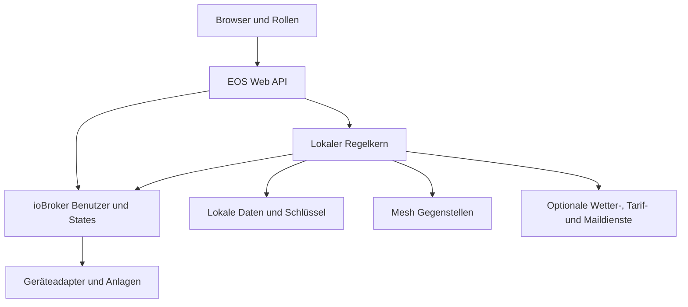

# Produktgrenzen, Komponenten und Datenflüsse

Stand: Prüfauftrag 29.09.2026; Basis `iobroker.nexowatt-ui` 1.0.21.

## Zweck und Lieferumfang

Der Adapter stellt EOS-Bedienoberflächen, HTTP-APIs, Livewerte und lokale Energie-,
Lade- und Gebäuderegelung bereit. Er liest ioBroker-Objekte und Zustände und schreibt
konfigurierte Sollwert-Datenpunkte. Eine kompromittierte Instanz kann deshalb über
eine reine Anzeige hinaus auf Anlagenfunktionen wirken. Unabhängige elektrische
Schutzfunktionen, Netzschutz und geräteeigene Grenzwerte müssen erhalten bleiben.

Das vorgesehene EOS-Profil umfasst industrienahen Betrieb auf einem Raspberry Pi 5
mit Linux, ioBroker/js-controller und konkret freigegebenen Geräteadaptern. Dies
erweitert die notwendige Systembewertung, nicht den hier tatsächlich ausgeführten
Hardwaretestumfang. Entwicklungsprozess (IEC 62443-4-1), Komponente
(IEC 62443-4-2) und Anlagenverbund einschließlich Netzsegmenten/VPN
(IEC 62443-3-3) sind getrennt zu bewerten; ein Paketreview belegt keine
IEC-Zertifizierung oder einen erreichten System-Security-Level.

Geprüfte Artefaktgrenze dieses Auftrags ist das hochgeladene Repository samt
ausführbaren Spiegeln, Browserressourcen, Admin-Quellen und Paket-/Builddateien.
Die maßgeblichen Laufzeitquellen stehen in `src-ts/runtime-executables/`; generierte
Ausgaben dürfen nicht vom geprüften Quellstand abweichen.

| Bestandteil | Im vorliegenden Repository / Bewertung |
| --- | --- |
| EOS UI, lokale EMS-Module, Mesh-Funktionen, Benachrichtigungen | Eigener Quellcode vorhanden; geprüfte Teilfunktionen und Änderungen stehen im aktuellen Prüfbericht |
| Express, Nodemailer, ioBroker-Hilfsbibliotheken | Paketabhängigkeiten; tatsächlich aufgelöste Versionen und transitive Komponenten gehören ins Komponentenregister und in die SBOM |
| React/Admin-Build und Buildwerkzeuge | Eigene und fremde Bestandteile; ausgelieferte Browserbundles mit Herkunft und Buildbezug erfassen |
| ioBroker js-controller und ioBroker Admin / EOS Admin | Eigenständige Laufzeit-/Administrationskomponenten; keine vollständigen Quellpakete oder Endgeräteinstallationen Bestandteil dieses Auftrags |
| nexowatt-devices, EEBUS, Installer, Backup | Schnittstellen bzw. Systemabhängigkeiten, deren eigenständige Repositorys hier nicht geliefert und nicht geprüft wurden |
| Modbus, MQTT, OCPP, InfluxDB, JavaScript, OpenKNX, Matter, Homematic IP und weitere Gerätetreiber | Für den EOS-Systemumfang je nach Freigabeliste relevant; keine pauschale Freigabe aus diesem UI-Review |
| Linux, Node.js, Hardware, Firmware, Netzwerk/VPN, Reverse Proxy | Installationsbestandteile; das Paket verlangt Node.js >=22, ein konkretes ausgeliefertes Image wurde nicht geprüft |

„Unterstützt“, „freigegeben“, „ausgeliefert“, „installiert“ und „aktiv“ sind getrennte
Felder einer Anlagenstückliste. Ein im UI auswählbarer Adapter belegt keinen dieser
anderen Zustände. Für jede Serienanlage sind Modell, Version, Hash, Konfiguration,
Supportende, offene Advisories und tatsächlicher Aktivierungszustand nachzutragen.
Das gilt auch für einen Fork: Umbenennen ersetzt weder Pflege noch Prüfung.

Die SBOM-Dateien stehen im [SBOM-Index](../../release-manifests/sbom-index.json).
`sbom-{root,admin}-lockfile.cdx.json` beschreibt das Lockdateiinventar,
`sbom-{root,admin}-installed.cdx.json` den tatsächlich installierten Baum der
jeweiligen Buildumgebung. `*-installed-runtime.cdx.json` grenzt die installierten
Produktionsabhängigkeiten ab. `sbom-admin-bundle.cdx.json` enthält die npm-Pakete,
deren JavaScript laut Rollup-Modulgraph tatsächlich in die gebauten Admin-Assets
eingeflossen ist; `admin-bundle-components.json` bindet diesen Nachweis an Quellen
und Assethashes. Buildwerkzeuge sind nicht automatisch zur Laufzeit ausgelieferte
Komponenten. Bilder, Schriften, externe Skripte und die vollständige EOS-Geräte-SBOM
werden damit nicht vollständig abgedeckt.
Details und aktuelle Advisories: [Lieferkettenprüfung](../security/supply-chain-review-de.md).

## Lokale Regelung und optionale Verbindungen

Der Regelkern läuft lokal. Der vorhandene Code enthält trotzdem Onlinefunktionen.
Eine Aussage „keine Verbindung nach außen“ ist nur für eine entsprechend
konfigurierte und auf Netzebene geprüfte Installation zulässig.

Für externe Strompreis-, Wetter-/PV-Prognose-, OAuth- und Geocodingabrufe gilt
im ergänzten EOS-Profil: ausschließlich HTTPS, ein gemeinsames konfiguriertes
Zeitbudget von höchstens 5.000 ms je vollständigem externem Wetter- bzw. Tarifabruf,
abgefangene Offline-/Transportfehler und vollständige Validierung der verwendeten
JSON-Struktur vor dem Schreiben von Nutzdaten-States. Geocoding, OAuth und
notwendige Teilanfragen/Fallbacks teilen dieses Budget; es gibt keine
Inline-Wiederholungen mit neuer voller Frist. Das gilt auch für konfigurierte
Providerendpunkte. Die Abrufgrenze und die Abgrenzung zu lokalem ioBroker-I/O sind im
[Ergänzungsnachweis](../reports/cra-2026-09-29/HTTPS_5S_CRA_IEC_ANFORDERUNGEN_DE.md)
auszuweisen. Eine Zeitgrenze für optionale Datenbeschaffung ersetzt keine
gerätespezifische Regelzyklus- oder Schutzreaktionszeit.

| Fluss | Daten / Richtung | Umsetzung und Sicherheitsgrenze |
| --- | --- | --- |
| F1 Browser ↔ EOS-Webserver | Anmeldedaten, Sitzungscookies, Bedienbefehle, Konfiguration, Messwerte, SSE | `main.ts`; Kunde, Installer, Admin und Stationsdisplay trennen. `io-package.json` bindet initial `0.0.0.0:8188`; HTTP-Listener benötigt abgesicherte Bereitstellung |
| F2 EOS ↔ ioBroker | Benutzerprüfung, Gruppen, Objektbaum, Messwerte, Sollwerte | Adapter-/Controller-Grenze; UI-Rollen ersetzen keine Host-/ioBroker-Rechte. Fremdadapter können dieselben Zustände beeinflussen |
| F3 EOS → Dateien / ioBroker-States | Konfiguration, SMTP-Geheimnisse, Mesh-Schlüssel, Zählerarchive, Ereignisse, Historie | `notification-mail.ts`, `mesh-coordinator.ts`, `mesh-energy-journal.ts`, `main.ts`; Dateirechte, Schlüsselzugang, Aufbewahrung und Sicherung prüfen |
| F4 EOS ↔ Geräteadapter ↔ Feldgeräte | Leistung, Strom, SOC, Temperaturen, Freigaben | EMS-Schreibpfade; Protokolle können unverschlüsselt sein. Integritäts- und Ausfallprüfungen sind gerätespezifisch |
| F5 EOS ↔ Mesh-Gegenstellen | Knoten-/Clusterkennung, Leistungen, Befehle, Zählerdaten | `mesh-coordinator*.ts`, `mesh-energy-service.ts`; authentifizierte Nachrichten, Wiederholschutz, Transport und Netzsegment getrennt prüfen |
| F6 EOS → SMTP-Anbieter → Empfänger | Empfängeradresse, Anlagenereignisse, technische Statuswerte | `notification-mail.ts`; TLS mit Zertifikatsprüfung vorgesehen, Zugangsdaten lokal verschlüsselt. Versand ist externe Datenübermittlung |
| F7 EOS → Prognose-/Wetterdienst | Standort/Koordinaten, Prognoseparameter; Wetter-/Strahlungsantwort | `open-meteo-pv-forecast.ts` und Wetterabruf in `main.ts`; Open-Meteo-Endpunkte, einschließlich optionaler Kunden-API/Geocoding |
| F8 EOS → Tarifanbieter | Anbieterparameter, je nach Anbieter Token/Kontobezug; Preisdaten zurück | `tariff-provider-registry.ts`; u. a. Tibber, EnergyZero, ENTSO-E sowie konfigurierte Endpunkte. Quellenwerte bleiben unvertrauenswürdige Eingaben |
| F9 Paketquelle → Installationsumgebung | npm-/Repositorypakete, Prüfsummen und Updates | Außerhalb des laufenden Regelkerns; Herkunft, Integrität und Updateberechtigung müssen auf Systemebene nachgewiesen werden |

Ein VPN schützt den Transport, beseitigt aber keine Berechtigungsfehler in EOS
oder ioBroker. Netzsegmentierung, Hostrechte und Anwendungsrechte wirken zusammen.
Ein kompromittierter Adapter in derselben ioBroker-Umgebung ist ein eigener
Angreiferfall; die UI kann diese Laufzeit nicht allein absichern.

## Daten und Löschung

Zu schützende Daten umfassen Zugangsdaten, Lizenz-/Verbindungsschlüssel,
Benutzerzuordnungen, Empfängeradressen, Standorte, Gerätebezeichnungen sowie
Verbrauchs- und Ladevorgänge. Auch technische Hauskennungen und Zeitreihen können
Personenbezug ermöglichen; „ohne Namen“ bedeutet nicht automatisch anonym.
Das Anlagenverzeichnis muss je Datengruppe Zweck, Empfänger, Berechtigung,
Aufbewahrungsfrist und Löschweg festlegen. Ein öffentliches Stationsdisplay darf
nur die für diese Station vorgesehenen Informationen erhalten.

Vor Entsorgung/Betreiberwechsel: Benutzerzugänge, SMTP-Zugang, API-Tokens,
Mesh-Kopplungen, Archiv-/Backupdaten und ggf. VPN-Identität gezielt entziehen oder
löschen. Ein vollständiger geprüfter Werksreset des gelieferten EOS-Endgeräts ist
noch kein Nachweis dieses Repository-Reviews.

## Lizenzgeheimnis und private Bereitstellung

Der vorherige Paketstand enthielt einen fest eingebauten HMAC-Wert für die lokale
Lizenzprüfung. **NW-SECRET-01** führt diesen bestätigten Befund im
[Befundregister](../security/BEFUNDREGISTER_DE.md). Der Wert ist als potenziell
offengelegt zu behandeln; seine Entfernung aus künftigen Paketen macht frühere
Kopien nicht geheim. Bestehende Lizenzschlüssel erfordern eine abgestimmte
Bereitstellungs-/Rotationsstrategie.

Die zwischenzeitliche Auslagerung verlangte die geschützte Prozessvariable
`NEXOWATT_LICENSE_HMAC_SECRET` und sperrte Bestandsanlagen ohne zusätzliche
Dienstumstellung. Auf ausdrücklichen Nutzerauftrag vom 23.10.2026 stellt 1.0.26
deshalb die historische NW1-Prüfung wieder bereit. Vorhandene Voll- und
Testlizenzen werden mit ihrer UUID, Edition und ursprünglichen Laufzeit geprüft;
die bloße Abwesenheit der Dienstvariable ist kein Sperrgrund mehr. Eine bereits
gültig eingerichtete private Signaturbasis bleibt zusätzlich verwendbar und
schließt gültige Altkeys nicht aus. Neue Dienstgeheimnisse bleiben außerhalb
der ausgelieferten Quellen.

Diese Entscheidung erhält die Feldtest-Kompatibilität, beseitigt jedoch nicht
NW-SECRET-01: Das historische symmetrische Material ist aus alten und aktuellen
Paketen lesbar. Es ist kein Authentifizierungsgeheimnis und keine belastbare
Grenze gegen eine Nachbildung von Lizenznachweisen. Anmeldung, Rollen, API- und
Geräteschutz bleiben unabhängig davon erhalten. Die spätere Lizenzmigration ist
der eigenen EOS-Software vorbehalten. Aktueller Betrieb und Prüfbezug:
[Lizenz- und EMS-Kompatibilität](../operations/EMS_APPS_LIZENZ_KOMPATIBILITAET_DE.md).
Der [Auslagerungsbericht](../reports/cra-2026-09-29/LIZENZ_SECRET_AUSLAGERUNG_DE.md)
beschreibt den historischen Zwischenstand und ist keine aktuelle Updatevoraussetzung.
