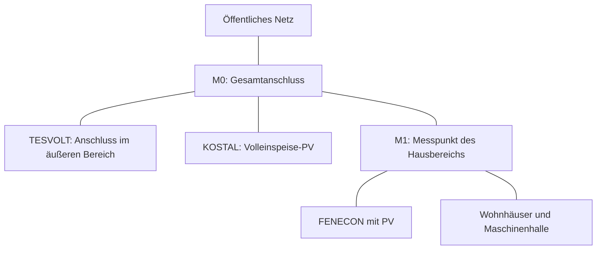

# NexoWatt UI: statischer und dynamischer NVP mit zugeordneten Speicherbereichen

**Dokument:** Umsetzungsvorgabe für den bestehenden funktionsfähigen UI-Adapter  
**Kennung:** NW-UI-NVP-ZONEN-20261022  
**Version:** 1.0 · 22.10.2026  
**Status:** Fachliche und technische Soll-Spezifikation; noch keine implementierte Funktion oder Anlagenfreigabe

## 1. Arbeitsauftrag und verbindliches Ziel

Den aktuell funktionsfähigen NexoWatt-UI-Adapter abwärtskompatibel um zwei auswählbare NVP-Betriebsarten erweitern:

1. **Statisch – ein NVP:** Das bisherige Verhalten mit einem zentralen Netzverknüpfungs-/Regelmesspunkt bleibt erhalten.
2. **Dynamisch – übergeordneter NVP und lokaler Regelbereich:** M0 erfasst und begrenzt den Gesamtstandort. M1 erfasst einen darunterliegenden Bereich. Speicher und PV-Geräte werden ihrem tatsächlichen Anschlussbereich und Regelzweck zugeordnet. Jeder untergeordnete Bereich bleibt den Grenzen von M0 unterworfen.

Die Zuordnung und die unterschiedlichen Speicheraufgaben werden in die bestehende **Speicherfarm-App** integriert. Ein einzelner Speicher muss dieselben Zuordnungen nutzen können, ohne eine künstliche Mehrspeicherfarm anlegen zu müssen. Die bestehende Speicherregelung wird wiederverwendet; ihre Mess- und Sicherheitskontexte werden ausdrücklich getrennt.

**„Statisch“ und „dynamisch“ bezeichnen hier die NVP-Topologie und Koordination.** Statisch bedeutet nicht konstante Speicherleistung oder eine abgeschaltete dynamische Regelung. Vorhandene Tarif-, Eigenverbrauchs-, Peak-Shaving- und Einspeisefunktionen bleiben im statischen Modus erhalten.

Der erste vollständige Lieferumfang umfasst **M0 und M1 auf einer EOS-Instanz**. Weitere Unterbereiche können später mit demselben Datenmodell ergänzt werden. Zwei EOS-Geräte, eine Cloud-Regelung oder eine aktive Microgrid-Verbindung sind dafür keine Voraussetzung.

### Umsetzung auf dem richtigen Ausgangsstand

- Ziel ist die vom Betreiber verwendete, funktionsfähige Arbeitskopie des UI-Adapters. Vor Änderungen deren Repository, Version, Commit und vorhandene Projektanweisungen feststellen.
- Keine Neuinstallation, Repository-Migration, Laufzeitumstellung oder vollständige Neuentwicklung aus diesem Auftrag ableiten.
- Die unten genannten Quellpfade sind überprüfte Referenzstellen. Weicht die aktuelle Arbeitskopie ab, die entsprechenden Funktionen darin ermitteln und Änderungen dort einarbeiten.
- Vorhandene Geräteprofile, Datenpunkte, Einheiten, Lizenzgrenzen, Betriebsarten und Schutzfunktionen erhalten. Neue öffentliche Datenpunkte und Konfigurationsfelder versionieren.
- Dieses Dokument beauftragt die beschriebene Entwicklung als Übergabevorgabe. Es enthält keine bereits durchgeführte Codeänderung, Veröffentlichung oder Inbetriebnahme.

## 2. Referenzanlage und Messgrenzen

Die Referenzanlage besitzt einen gemeinsamen Niederspannungsanschluss mit angegebener Leistung von 250 kW, einen TESVOLT-Arbitragespeicher mit 250 kW, eine KOSTAL-Volleinspeise-PV mit 99 kWp und einen untergeordneten Hausbereich mit FENECON Commercial 100, weiterer PV mit 99 kWp, drei Wohnhäusern und einer Maschinenhalle.

Import- und Exportberechtigung sowie die jeweiligen Anschlusswerte sind getrennt zu hinterlegen. Die Angabe 250 kW in beide Richtungen ist für diese Spezifikation eine Projektannahme, keine geprüfte Netzanschlusszusage. 99 kWp PV ist eine DC-Angabe und nicht automatisch die AC-Bezugsleistung eines Regelsignals.

Die Linien zeigen die Bilanzgrenzen, keinen ausführungsreifen Stromlauf- oder Abrechnungsplan.

| Bereich | Erfasste Geräte und Leistungen | Regelaufgabe |
| --- | --- | --- |
| M0 | TESVOLT, KOSTAL und der gesamte M1-Zweig | Gesamtbezug und Gesamteinspeisung begrenzen; Standortbudgets vergeben |
| M1 | FENECON, seine PV und die nachgelagerten Verbraucher | Eigenverbrauchsoptimierung, optional lokale Nulleinspeisung und lokale Leistungsgrenzen |
| Äußerer Bereich | Geräte hinter M0, aber außerhalb von M1 | Beispielsweise Arbitrage oder Peak-Shaving über einen hierfür zugeordneten Speicher |

**M0 enthält M1 bereits.** M0 und M1 dürfen nicht als zwei unabhängige Lasten addiert werden. Interne PV- und Speicherwerte werden nur für nachvollziehbare Teilbilanzen, Prognosen und Stellwirkungsberechnungen verwendet.

**Ein außerhalb von M1 angeschlossener TESVOLT beeinflusst den Messwert M1 nicht direkt.** Er kann daher eine lokale Nulleinspeisung an M1 nicht durch eigenes Laden herstellen. Dafür müssen Speicher, PV-Abregelung oder geeignete Verbraucher hinter M1 wirken.

## 3. Verbindliche Architekturregeln

| ID | Muss-Anforderung |
| --- | --- |
| NVP-01 | Ohne neues Konfigurationsfeld gilt statischer Betrieb; es erfolgt keine automatische Aktivierung des dynamischen Modus. |
| NVP-02 | M0 ist im dynamischen Modus immer die übergeordnete Anschlussgrenze. Kein Tarif-, Komfort-, Handels- oder Farmmodus darf sie überschreiben. |
| NVP-03 | Physischer Anschlussbereich, lokaler Regelmesspunkt, Betriebsaufgabe und Stellhoheit sind getrennte Angaben. |
| NVP-04 | Pro physischem Aktor existiert genau ein endgültiger Schreibpfad. Mehrere Planer dürfen Anforderungen liefern, aber nicht unabhängig auf das Gerät schreiben. |
| NVP-05 | Alle gleichzeitig möglichen Speicherleistungen und noch wirksamen Freigaben werden gemeinsam bilanziert. Das Restbudget wird nicht mehrfach vergeben. |
| NVP-06 | Eine erlaubte Leistung ist keine tatsächlich ausgeführte Leistung. Empfang, angewandte Grenze und gemessene Wirkung sind getrennte Zustände. |
| NVP-07 | Eine strengere lokale Grenze bleibt wirksam. M1-Nulleinspeisung darf die erlaubte Einspeisung am M0 nicht pauschal auf null setzen. |
| NVP-08 | M0-Messung, M1-Messung und Geräte-Istleistungen besitzen eigene Frische- und Qualitätsprüfungen sowie eine zulässige zeitliche Abweichung zueinander. |
| NVP-09 | Fehlende Werte, unbekannte Gerätefähigkeiten und abgelaufene Freigaben dürfen keine neue zusätzliche Leistung freigeben. |
| NVP-10 | Eine Speicherfarm mit unterschiedlichen Bereichen wird in explizite Regel-/Dispatchgruppen aufgeteilt. Ein gemeinsamer ungetrennter Leistungsverteiler ist dafür unzulässig. |

## 4. Konfigurationsmodell und Zuordnung

Die nachstehenden Feldnamen sind ein **Schemaentwurf**, keine Behauptung bereits vorhandener API-Felder. Vorhandene Konfiguration sinnvoll erweitern und die tatsächlichen Feldnamen anschließend dokumentieren.

### 4.1 NVP-Modell

| Feld | Inhalt |
| --- | --- |
| `schemaVersion` | Version des neuen Konfigurationsschemas |
| `mode` | `static` oder `dynamic`; fehlend bedeutet `static` |
| `operation` | Im neuen dynamischen Pfad `diagnostic` oder `active`; Diagnose erzeugt keine neuen Gerätesollwerte |
| `rootPointId` | Im dynamischen Modus `M0` |
| `points[]` | M0 und M1 mit eindeutiger ID, Name, Messzuordnung, Elternbezug und Grenzwerten |
| `parentId` | M0 ohne Elternpunkt, M1 mit Elternpunkt M0 |
| `measurement` | Datenpunkt, Einheit, Vorzeichen, Aktualisierung, Altersgrenze, Zeitstempel und Qualitätsstatus |
| `importLimitW` / `exportLimitW` | Getrennte, nichtnegative Anschluss-/Bereichsgrenzen; 0 ist eine echte Grenze |
| `importReserveW` / `exportReserveW` | Getrennte Reserven, die nicht zusätzlich als frei verfügbares Budget verteilt werden |
| `phaseLimitsA` / `apparentPowerLimitVA` | Soweit für die Anlage erforderlich: Phasen- und Scheinleistungsgrenzen samt Messungen |
| `failurePolicyId` | Zugeordnete und geprüfte Rückfallstrategie für diesen Bereich |

In M1 darf eine nicht benötigte vertragliche Bereichsgrenze ausdrücklich als „nicht konfiguriert“ modelliert werden. Eine unbekannte Grenze darf weder als 0 noch als unbegrenzt umgedeutet werden. Erforderliche Leitungs-/Phasengrenzen müssen für den aktiven Betrieb dennoch vorliegen.

Identische physische Zähler hinter verschiedenen Aliasnamen dürfen nicht als unabhängige M0/M1-Messungen verwendet werden. Bei virtuellen Messpunkten sind Herkunft, Berechnung, Signale und Fehlerverhalten gesondert nachzuweisen; die erste Umsetzung bevorzugt zwei reale Messungen.

### 4.2 Speicherzuordnung

| Feld | Bedeutung |
| --- | --- |
| `connectionPointId` | Physischer Anschluss: äußerer M0-Bereich oder hinter M1 |
| `controlPointId` | Messpunkt der lokalen Regelaufgabe |
| `ancestorGuards` | Aus der Topologie abgeleitete zusätzliche Grenzen; bei M1 enthält dies zwingend M0 |
| `dispatchGroupId` | Zugehörige homogene Regel-/Verteilgruppe innerhalb der Farm |
| `primaryPurpose` | Eigenverbrauch, lokale Nulleinspeisung, Peak-Shaving, Tarifbetrieb oder externe Arbitrage |
| `authority` | `eos` oder `external`; Hersteller-Sicherheitsfunktionen bleiben unabhängig wirksam |
| `capabilities` | Tatsächlich unterstützte Leistungsbefehle, Leistungsgrenzen, Watchdog, Istwerte und Rückmeldungen |
| `powerAndSocLimits` | Lade-/Entladeleistung, SoC-Grenzen, Rampen, Verfügbarkeit und gegebenenfalls reservierte Energie |
| `inverterGroupId` | Gemeinsame AC-Leistungsgrenze bei Hybrid-PV und Batterie |

Für den ersten Lieferumfang muss ein Gerät seinen eigenen Anschlussbereich regeln oder einem ausdrücklich geprüften übergeordneten Zweck dienen. Unbeabsichtigte bereichsübergreifende Eigenverbrauchsregelung verhindern: FENECON an M1 soll den TESVOLT-Handel an M0 nicht automatisch ausgleichen.

## 5. Speicherfarm-App und Betriebsarten

Die Farm-App erhält zwei Organisationsformen:

- **Gemeinsame Regelung:** vorhandene Farm an einem gemeinsamen Regelmesspunkt; bestehende Leistungsaufteilung weiterverwenden.
- **Bereichs- und aufgabenbezogene Regelung:** gemeinsame Verwaltung, aber getrennte Dispatchgruppen für M0/M1, Betriebsaufgaben und Stellhoheiten. Oberhalb dieser Gruppen verteilt der M0-Koordinator die zulässigen Budgets.

Damit dürfen in derselben Farm-App unterschiedliche Aufgaben sichtbar sein, ohne dass die Speicher zwangsläufig denselben Sollwert oder dieselbe Richtung erhalten.

| Betriebsaufgabe | Typischer Regelpunkt | Verhalten |
| --- | --- | --- |
| Eigenverbrauchsoptimierung | M1 | Vorhandene Speicherlogik nutzt den lokalen Nettoleistungswert und das bestehende Regelziel. |
| Lokale Nulleinspeisung | M1 | Lokale Speicheraufnahme und nötigenfalls lokale PV-Abregelung halten die M1-Exportgrenze; Aufnahmefähigkeit ist endlich. |
| Peak-Shaving | M0 oder ausdrücklich eigener Bereich | Zugeordneter EOS-Speicher begrenzt Spitzen, soweit Leistung und Energie verfügbar sind. Momentangrenze und RLM-Ziel getrennt behandeln. |
| Externe Arbitrage | M0 im Referenzprojekt | Externer Betreiber wählt den Fahrpunkt; EOS gibt den zulässigen Korridor vor. |
| Tarifgeführter Betrieb | Zugeordneter Bereich | Bestehende EOS-Tariffunktion innerhalb lokaler und übergeordneter Grenzen; nur bei EOS-Stellhoheit. |

Pro Bereich darf ein gemeinsamer Bilanzfehler nicht durch mehrere unabhängige Eigenverbrauchsregler doppelt kompensiert werden. Der Bereichsplaner ermittelt den Bedarf einmal; die Farm verteilt ihn anschließend auf die zugeordneten, verfügbaren Speicher.

Eine Mehrfachnutzung desselben Speichers ist nur mit dokumentierter Priorität und gemeinsamen Leistungs-/Energiereserven zulässig. Ein extern arbitragierender Speicher ist **nicht automatisch** gleichzeitig verlässlich für EOS-Peak-Shaving verfügbar. Hierfür ist entweder ein bestätigter Leistungs-/SoC-Reservierungsvertrag mit dem externen Regler oder ein anderer regelbarer Speicher erforderlich.

Ein Wechsel der Betriebsaufgabe überträgt die Stellhoheit nicht stillschweigend. Bei `external` darf der normale EOS-Speicher-Writer keine parallelen Lade-/Entladebefehle oder Keepalives erzeugen, die den Handelsregler überschreiben.

## 6. Messkontexte statt Umschalten eines globalen Datenpunkts

Die bestehende Regelung darf nicht dadurch mehrfach verwendet werden, dass während eines Regelzyklus der globale NVP-Datenpunkt zwischen M0 und M1 umgeschaltet wird.

Benötigt werden voneinander getrennte, über den gesamten Zyklus konsistente Kontexte:

1. **Standortkontext M0:** Gesamtmessung, harte Grenzen, Betriebsgrenzen, Phasen, Reserven und übergeordnete Budgetierung.
2. **Bereichskontext M1:** lokale Messung, lokale Grenzwerte, Eigenverbrauchs-/Nulleinspeiseziel und lokaler Reglerzustand.
3. **Gerätekontext:** Istleistung, Betriebszustand, SoC, Grenzen und Schreibeigentümer.

Reglerzustände wie Filter, Integrator, Hysterese, Rampen und letzte Sollwerte werden je Bereich/Dispatchgruppe geführt. Kein versehentlich gemeinsam genutzter Integrator. Sättigung durch M0 muss an den lokalen Regler zurückgemeldet werden, damit sich sein Reglerzustand nicht gegen die Begrenzung aufbaut.

Die bisherige statische Regelung erhält ihren bisherigen Kontext. Neue dynamische Instanzen werden nur nach ausdrücklicher Konfiguration erzeugt. Die vorhandenen Diagnose- und Visualisierungswerte dürfen nicht unbemerkt ihre Bedeutung von Gesamtstandort zu Hausbereich ändern.

## 7. Vorzeichen, Bilanz und Leistungsberechnung

### 7.1 Einheitliche interne Konvention

- NVP-Leistung `g > 0`: Netzbezug; `g < 0`: Einspeisung.
- Speicherleistung `p > 0`: Entladung ins AC-System; `p < 0`: Laden aus dem AC-System.
- PV-Erzeugung wird als positiver Erzeugungsbetrag geführt.
- Intern W und A verwenden; kW nur zur Anzeige beziehungsweise in den Rechenbeispielen.
- Herstellervorzeichen ausschließlich an der Geräteadaptergrenze übersetzen und testen.

Eine bekannte Änderung der Speicherleistung wirkt idealisiert so:

`g_neu = g_ist − (p_neu − p_ist)`

Das gilt nur für Messpunkte, die den betreffenden Speicher elektrisch enthalten. Der Einfluss von TESVOLT auf M1 ist im Referenzaufbau null; der Einfluss von FENECON auf M0 und M1 ist jeweils vorhanden.

| Stellglied | Wirkung auf M0 | Wirkung auf M1 |
| --- | --- | --- |
| TESVOLT im äußeren Bereich | Ja | Nein |
| KOSTAL im äußeren Bereich | Ja | Nein |
| FENECON hinter M1 | Ja | Ja |
| PV hinter M1 | Ja | Ja |

Bei Hybridgeräten ist die gemeinsame AC-Leistungsgrenze zu beachten. PV-Leistung und Batterieleistung dürfen nicht als zwei unabhängig voll verfügbare Wechselrichterleistungen addiert werden. Zur Rückrechnung benötigte Batterie-Istleistung muss eine eindeutig definierte AC-Wirkung besitzen; ein hybrider Gesamt-AC-Messwert inklusive PV ist kein beliebig austauschbarer Batterie-Istwert.

### 7.2 TESVOLT-Korridor

Für einen extern gesteuerten TESVOLT mit aktueller Leistung `pT` ergibt sich die momentane Restleistung ohne diesen Speicher aus:

`r = g_M0 + pT`

Diese Restleistung enthält den M1-Zweig bereits. Geplante Änderungen an FENECON, PV und Lasten müssen entsprechend ihrer Wirkung und ihres tatsächlichen Ausführungszustands berücksichtigt werden.

Für einen bekannten Restwert und die M0-Betriebsgrenzen `I` für Bezug und `E` für Einspeisung gilt:

`pT_min = r − I`

`pT_max = r + E`

Das zulässige Intervall wird mit Geräte-, SoC-, Temperatur-, Rampen- und Verfügbarkeitsgrenzen geschnitten.

Für unsichere beziehungsweise noch im Übergang befindliche Restleistung `r ∈ [r_min, r_max]` gilt konservativ:

`pT_min = r_max − I`

`pT_max = r_min + E`

Diese Restleistungsgrenzen müssen die gesamte Gültigkeitsdauer der Freigabe einschließlich relevanter Übergänge abdecken. Dazu gehören zulässige Änderungen des M1-Reglers, Last-/PV-Änderungen, Messfehler, Rampen und verfügbare Energie. Der zuletzt gemessene M1-Wert allein ist kein ausreichender Garant für eine länger gültige Freigabe. Die angenommene Störungsmenge muss dokumentiert und zur gewählten Reserve passen.

Eine Übermittlung ausschließlich als nichtnegative `maxChargeW` und `maxDischargeW` ist nur ausreichend, wenn das zulässige Intervall **0 enthält**:

`maxChargeW = −pT_min` und `maxDischargeW = pT_max`

**Enthält das Intervall 0 nicht, ist eine bestimmte Lade- oder Entladeleistung zwingend erforderlich.** Reine Maximalfreigaben können das nicht erzwingen. Dann müssen ein dafür bestätigter Sollwert-/Mindestleistungsmechanismus, ein anderer verfügbarer Aktor oder eine definierte Last-/PV-Reduktion beziehungsweise Schutzreaktion greifen. Ein leeres Intervall ist ein nicht erfüllbarer Betriebszustand und darf nicht als gültige Freigabe ausgegeben werden.

### 7.3 Nachvollziehbare Beispiele

Alle Werte dieser Tabelle in kW; Betriebsgrenzen I = E = 225, TESVOLT-Gerätegrenzen −250 bis +250. Die Beispiele berücksichtigen keine zusätzlichen SoC-/Phasenbeschränkungen.

| Restleistung ohne TESVOLT | Zulässiger TESVOLT-Bereich nach Gerätegrenze | Aussage |
| --- | --- | --- |
| +20 Bezug | −205 bis +245 | Maximal 205 laden oder 245 entladen. |
| −180 Einspeisung | −250 bis +45 | Höchstens 45 zusätzlich entladen; bis 250 laden ist vom Wirkleistungsbudget möglich. |
| +260 Bezug | +35 bis +250 | Mindestens 35 entladen oder andere Entlastung nötig; bloße Maximalfreigabe reicht nicht. |
| −260 Einspeisung | −250 bis −35 | Mindestens 35 laden oder Erzeugung anderweitig reduzieren. |
| Restbereich −20 bis +60 | −165 bis +205 | Unsicherheit reduziert beide Richtungsfreigaben. |

### 7.4 Übergänge nicht vorzeitig als Entlastung buchen

Beispiel: M0 misst +130 kW, TESVOLT lädt mit 40 kW (`pT = −40`), FENECON entlädt mit 20 kW. Die Restleistung ohne TESVOLT ist +90 kW. FENECON soll künftig 50 kW entladen; erst nach wirksamer Umsetzung sinkt die Restleistung auf +60 kW.

Während des Übergangs ist `r ∈ [60, 90]`. Zulässig sind zunächst höchstens **135 kW TESVOLT-Ladung**. Würden schon 165 kW freigegeben, ergäben sich vor der FENECON-Reaktion **255 kW Bezug**. Erst nach bestätigter Wirkung und frischen Messungen darf die Freigabe auf 165 kW steigen.

Ein Schreib-ACK auf einen Datenpunkt reicht als Wirkungsnachweis nicht aus. Noch geltende alte Freigaben bleiben reserviert. Bei unbekanntem Übergangsverhalten den konservativen Bereich aus alter und neuer Leistung beziehungsweise die nachgewiesenen Geräte-/Rampenbounds verwenden.

Das gilt auch in Gegenrichtung: Eine unterstützende FENECON-Entladung darf nicht reduziert werden, solange eine noch gültige TESVOLT-Ladefreigabe von ihr abhängig ist. Beispiel: Restlast 50 kW und TESVOLT-Ladefreigabe 175 kW ergeben 225 kW Bezug. Eine Verringerung der FENECON-Unterstützung um 30 kW würde mit alter Freigabe 255 kW ergeben. Zuerst muss TESVOLT wirksam auf höchstens 145 kW Laden begrenzt sein; erst danach darf FENECON seine Unterstützung zurücknehmen.

### 7.5 Mehrere Speicher und externe Teilnehmer

Für mehrere freie Teilnehmer werden gemeinsame Budgets verteilt, nicht die vollständigen Einzelbudgets mehrfach ausgegeben. Bei unabhängigen Leistungsintervallen `p_i ∈ [a_i, b_i]` und einem Restbereich ohne diese Teilnehmer gilt am betrachteten Messpunkt:

`g_min = r_min − Σ b_i`

`g_max = r_max − Σ a_i`

Erforderlich sind `g_min ≥ −E` und `g_max ≤ I`. Nur die am jeweiligen Messpunkt wirksamen Teilnehmer einbeziehen. Bereits verbindliche Altfreigaben und noch nicht wirksam begrenzte Geräte gehören in diese Prüfung.

Ein geplanter gegenläufiger Betrieb ist ohne verbindliche Kopplung keine garantierte Entlastung. Zwei Teilnehmer können gleichzeitig laden oder gleichzeitig entladen, auch wenn ihre Fahrpläne etwas anderes erwarten lassen.

## 8. Reserven, Prioritäten und Zyklusablauf

### 8.1 Reserve ausdrücklich abziehen

Beispiel für das Projekt: 250.000 W Anschlussgrenze minus 25.000 W Reserve ergeben 225.000 W als nicht zu überschreitende Grenze der normalen Budgetvergabe – getrennt für Bezug und Einspeisung.

Dieser Wert ist ein **Auslegungsbeispiel**, keine festgelegte ausreichende Sicherheitsreserve. Messverzögerung, Schalt-/Lastsprünge, Wechselrichterreaktion, Rampen, Phasenbelastung und Blindleistung bestimmen die nötige Auslegung.

Die vorhandene weiche 90-%-Planungsschwelle darf nicht mit einer dauerhaft reservierten Leistungsmenge verwechselt werden. Anschlussgrenze, feste Reserve, betriebliche Budgetgrenze und gegebenenfalls weitere Planungsschwelle in der Anzeige auseinanderhalten. Eine Reserve nicht versehentlich in mehreren Modulen doppelt abziehen.

### 8.2 Prioritäten

1. Geräte-/BMS-Grenzen, elektrische Schutzfunktionen und verbindliche Netzbetreibervorgaben.
2. Harte Grenzen von M0 und gegebenenfalls M1; alle gelten gleichzeitig. Bei Unvereinbarkeit wird ein Fehler-/Entlastungsfall behandelt, keine Grenze still übergangen.
3. Verbindliche Betriebsgrenzen einschließlich reserviertem Spielraum und erforderlicher lokaler Exportbegrenzung.
4. Bestätigte Peak-Shaving-/Energiereserven und ausdrücklich gewählte Projektprioritäten.
5. Eigenverbrauch, Tarifoptimierung, Arbitrage und andere wirtschaftliche Wünsche innerhalb des verbleibenden Rahmens.

Die Rangfolge wirtschaftlicher Ziele ist konfigurierbar. Eine Priorität erzeugt weder verfügbare Batteriekapazität noch garantiert sie eine Entlastung durch einen externen Regler.

Ein verbindliches Peak-Shaving-Ziel muss in die Budgetvergabe eingehen: Externes Arbitrage-Laden darf die dafür eingeplante Entlastung nicht wieder aufheben. Ein mangels Leistung oder Energie nicht erreichbares wirtschaftliches Ziel wird ausdrücklich als nicht erreichbar gemeldet. Es darf nicht mit einer Überschreitung der zulässigen Anschlussgrenze gleichgesetzt oder als erfüllt angezeigt werden.

### 8.3 Gemeinsamer Regelzyklus

1. Konsistenten Mess- und Gerätezustand einlesen; Alter, Qualität, Vorzeichen und zeitliche Abweichungen prüfen.
2. Netzbetreiber- und Gerätegrenzen sowie noch aktive Freigaben erfassen.
3. M1-Bedarf mit bestehender Speicherlogik bestimmen; lokale PV-Abregelung als Anforderung berechnen.
4. M0-Aufgaben wie Peak-Shaving und externe Arbitragefreigaben gemeinsam planen.
5. Gleichzeitige und übergangsweise mögliche Leistungen gegen alle betroffenen Grenzen prüfen.
6. Sichere Leistungsreduzierungen zuerst ausgeben; dadurch erwarteten Spielraum erst nach erforderlichem Nachweis anderweitig freigeben.
7. Je Aktor genau einen endgültigen Befehl beziehungsweise ein Freigabepaket ausgeben; direkt davor Frische, Gültigkeit und Steuerhoheit erneut prüfen.
8. Istwirkung überwachen, Abweichungen behandeln und begrenzte Anforderungen an lokale Regler zurückmelden.

Ändert sich eine relevante Messung, Grenze oder Topologie während eines asynchronen Schreibablaufs, darf ein früher berechneter höherer Folgebefehl nicht ungeprüft weiterlaufen.

## 9. TESVOLT und andere externe Speicherregler

Die Funktion wird herstellerneutral als **extern geführter Speicher mit Leistungsfreigaben** angelegt. Die tatsächliche TESVOLT-Schnittstelle implementiert ein Geräte-/Integrationsprofil. Unbestätigte Register, API-Endpunkte oder Timingwerte dürfen nicht erfunden werden.

### Freigabevertrag

Ein Freigabepaket muss semantisch mindestens enthalten:

- Teilnehmer- und Bereichskennung, Schema- und Konfigurationsversion;
- Sitzung/Neustartkennung und monoton steigende Sequenz;
- maximal zulässige Lade-/Entladeleistung oder einen ausdrücklich unterstützten signierten Korridor;
- begrenzte Gültigkeit und eindeutig vereinbartes Verfahren zur Ablaufbestimmung;
- aktive M0-Grenzen beziehungsweise Grund der Begrenzung, soweit das Protokoll dies vorsieht;
- Bestätigung des Empfangs, tatsächlich angewandte Grenzen und relevante Istleistung als getrennte Rückmeldungen.

Das Geräteprofil muss klären, wie verspätete, doppelte oder in falscher Reihenfolge eintreffende Vorgaben erkannt werden und was nach Kommunikationsausfall, EOS-Neustart und TESVOLT-Neustart geschieht. Ein eigener EOS-Timeout allein beendet keine im Fremdgerät weiterhin wirksame Freigabe.

### Regelhoheit und Planung

- TESVOLT Energy beziehungsweise der vereinbarte lokale TESVOLT-Regler entscheidet über den Fahrpunkt innerhalb des freigegebenen Bereichs.
- Der EOS-NVP-Koordinator darf parallel keine normale Eigenverbrauchsregelung auf denselben TESVOLT anwenden.
- Lokale harte Grenzen und gegebenenfalls externe Netzvorgaben sind mit der Handelsplattform abzustimmen, damit geplante und tatsächlich verfügbare Leistung auseinandergehalten werden.
- Priorisierte PV-Ladung, Netzladung bei günstigen Preisen und SoC-Reserven sind getrennte Betriebsanforderungen. Eine freie Ladeleistung ist kein Auftrag, tatsächlich zu laden.
- Unbegrenzter Weiterbetrieb mit letzter Freigabe ist kein zulässiger Standard. Den gerätespezifisch nachgewiesenen Rückfall verwenden.
- Erst ein bestätigtes Profil darf aktive externe Freigaben erzeugen. Bis dahin Diagnose/Simulation ohne zusätzliche Hardwarebefehle.

## 10. KOSTAL und PV: gemeinsamer finaler Sollwert

Die vorhandenen EVU-Stufen **100/60/30/0** weiterverwenden. Ergänzt wird eine eindeutige Zusammenführung mit der dynamischen NVP-Begrenzung.

Jede Eingangsanforderung erhält:

- Typ: Erzeugungsgrenze oder saldierte Exportgrenze;
- Geltungsbereich: einzelner Wechselrichter, PV-Gruppe, M1 oder M0;
- Bezugsleistung und Einheit;
- Gültigkeit, Herkunft und Fehlerverhalten.

Prozentwerte dürfen nicht automatisch aus 99 kWp DC in einen AC-Sollwert umgerechnet werden. Die mit Geräteprofil und Netzbetreiber festgelegte Bezugsgröße ist maßgeblich.

Erst nachdem die NVP-Exportgrenze anhand der tatsächlichen Bilanz und bestätigter Speicherwirkung in eine zulässige PV-Erzeugungsleistung umgerechnet wurde, gilt für denselben Wechselrichter:

`PV_final = min(Gerätegrenze, EVU-Erzeugungsgrenze, NVP-bedingte Erzeugungsgrenze, weitere gültige Erzeugungsgrenzen)`

Die Ausgabe erfolgt über **einen** endgültigen Writer. Die vorhandene Prüfung gegen doppelte Schreibziele bleibt bestehen; sie wird nicht durch eine Freigabe konkurrierender Regler umgangen. Der neue gemeinsame Writer ersetzt die entsprechenden konkurrierenden Ausgabepfade.

Besondere Fälle:

- 0 % für die KOSTAL-Erzeugung ist etwas anderes als 0 W Export am M0.
- Gilt die Vorgabe für den gesamten M0, müssen auch Speicher und weitere Erzeuger berücksichtigt werden.
- Gilt Nulleinspeisung nur für M1, bleibt KOSTAL außerhalb M1 davon unberührt, solange M0 seine eigenen Grenzen einhält.
- Ein voller, gesperrter oder kommunikationsloser FENECON darf nicht als verfügbare PV-Senke eingeplant werden.
- Eine bloße Ladefreigabe für einen externen Händler ist ebenfalls keine garantierte Senke: Er darf innerhalb eines solchen Korridors auch 0 W wählen. Auch aktuell gemessene Ladung ist dann keine garantierte zukünftige Aufnahme. Die PV-Freigabe muss für jede im gültigen Speichervertrag erlaubte Leistung sicher bleiben. Höhere PV-Leistung darf nur von verbindlich verfügbarer Mindestaufnahme abhängen. Bei geplanten Übergängen die erforderliche Senke erhalten, bis eine Erzeugungsreduzierung tatsächlich wirksam ist; ungeplante Ausfälle sind durch den geprüften lokalen Ausfallpfad abzudecken.
- Mehrere aktive Stufen ergeben die strengste gültige Vorgabe. „Keine Stufe aktiv“ darf nur bei bestätigter Kommunikationsqualität die vereinbarte Freigabe bedeuten; veraltete/ungültige Eingangssignale dürfen nicht still zu 100 % werden.
- Nach einer Lockerung nur innerhalb der Geräte- und Projektrampen erhöhen; neue Begrenzungen unverzüglich entsprechend den zulässigen Geräteabläufen umsetzen.

## 11. Fehlerfälle und sichere Wiederaufnahme

| Ereignis | Gefordertes Verhalten |
| --- | --- |
| M0 fehlt, ist unplausibel oder zu alt | Keine neuen zusätzlichen Standortfreigaben. Nachgewiesene lokale Rückfälle und noch aktive Altfreigaben berücksichtigen. Fehler sichtbar und protokolliert. |
| M1 fehlt oder ist zu alt | Lokale Regelung nicht mit einem erfundenen Nullwert fortsetzen. M0 darf nur mit einem nachgewiesenen konservativen Bereich für den M1-Zweig weiterbudgetieren; andernfalls entsprechender Rückfall. |
| Batterie-Istleistung fehlt | Keine präzise Restleistungsrückrechnung aus unbekannter Stellwirkung; geprüfte konservative Alternative oder Rückfall. |
| Externer Teilnehmer antwortet nicht | Keine Freigabeerhöhung; alte mögliche Wirkung bis zur nachgewiesenen Begrenzung/Ablösung weiter reservieren. |
| Teilnehmer bestätigt, folgt aber nicht | Abweichung aus Istwerten erkennen, zusätzliche Freigabe sperren und vereinbarte Entlastungs-/Schutzreaktion auslösen. |
| Freigabe läuft ab | Ablauf muss beim ausführenden lokalen Regler wirksam sein; Messung und Rückmeldung überwachen. |
| Speicher voll, leer oder leistungsgemindert | Tatsächliche Fähigkeit in den Grenzen reduzieren; andere Senken/Quellen nutzen oder PV/Last begrenzen. |
| EOS-/Geräteneustart | Keine alten Pakete als neue Freigabe übernehmen; neue Sitzung, Synchronisierung und begrenzte Wiederaufnahme. |
| Wiederkehr gültiger Messungen | Erst nach plausiblen stabilen Messungen und geklärter Steuerhoheit mit begrenzter Rampe neu freigeben. |

„Alle Speicher auf 0“ ist kein universell sicherer Zustand: Ein Speicher kann gerade eine Lastspitze oder PV-Überschüsse abfangen. Der Rückfall muss für die gesamte betroffene Bilanz funktionieren, auch wenn ein Teilnehmer nicht erreichbar ist. Kann das mit den vorhandenen Aktoren nicht garantiert werden, ist ein unabhängiger lokaler Begrenzungs-/Schutzpfad Bestandteil der Anlagenplanung.

## 12. Bedienoberfläche

### NVP-Einstellungen

Oben eine klare Auswahl:

- **Statisch – bisheriger Betrieb mit einem Messpunkt**
- **Dynamisch – Gesamtanschluss M0 mit lokalem Bereich M1**

Im statischen Modus bleibt die bisherige Bedienung erhalten. Im dynamischen Modus werden M0/M1-Zuordnung, Grenzen, Reserven, Qualitätsanforderungen und Gerätezugehörigkeiten sichtbar. Automatisch abgeleitete M0-Unterordnung darf nicht abgewählt werden.

### Speicherfarm

Pro Speicher beziehungsweise Gruppe anzeigen und bearbeiten:

- Name und tatsächlicher Anschlussbereich;
- Regelmesspunkt;
- Aufgabe/Betriebsart;
- EOS- oder externe Stellhoheit;
- Leistungs-/SoC-Grenzen und Reserven;
- wirksame übergeordnete Begrenzung;
- angefordert, freigegeben, angewandt und gemessen;
- Kommunikations-/Messqualität und verständlicher Begrenzungsgrund.

Geeignete Meldungen sind beispielsweise „Ladung durch M0 auf 135 kW begrenzt“, „Nulleinspeisung an M1: Speicheraufnahme ausgeschöpft, lokale PV wird reduziert“ oder „TESVOLT-Freigabe nicht bestätigt; bisheriger Spielraum bleibt reserviert“.

### Aktivierung und Änderung

Nur berechtigte Installer-/Adminrollen dürfen Topologie, Schutzgrenzen, Stellhoheit und Gerätezuordnungen ändern. Die Prüfung erfolgt serverseitig, nicht ausschließlich im Browser.

Vor Aktivierung: vollständige Konfiguration validieren und berechnete Wirkung in Diagnose zeigen. Speichern darf keine teilweise neue Topologie wirksam machen. Änderungen werden atomar mit Konfigurationsversion aktiviert. Während noch aktive Freigaben oder ungeklärte Schreibvorgänge bestehen, ist ein kontrollierter Übergang erforderlich.

## 13. Migration und Rückwärtskompatibilität

1. Bestehende Konfiguration vollständig sichern; vorherigen funktionsfähigen Stand und Rückweg dokumentieren.
2. Fehlenden Modus als statisch auflösen. Keine zusätzlichen Gerätezugriffe und keine geänderten Grenzwerte allein durch das Update.
3. Bestehende einzelne Speicher und gemeinsame Farmen behalten ihr bisheriges Verhalten und ihre sichtbaren Datenpunkte.
4. Für dynamischen Betrieb neue Bereichs-/Gruppenzuordnungen ausdrücklich anlegen. Vorhandene Speicher nicht automatisch anhand ihres Herstellers einsortieren.
5. Beim Wechsel alle bisherigen Schreibverantwortlichen ermitteln, offene Befehle/Freigaben kontrolliert ablösen und erst dann neue Verantwortliche aktivieren.
6. Reglerzustände passend neu initialisieren; keine alten Integratoren oder zuletzt gültigen dynamischen Budgets in einen anderen Bereich übernehmen.
7. Rückkehr zu statisch nur mit validierter Messzuordnung und geklärter externer Steuerhoheit. Kein automatischer Rückfall auf statisch bei einem Fehler im dynamischen Betrieb.
8. App-Deaktivierung, Deinstallation oder Lizenzwechsel dürfen aktive Schutzgrenzen und extern noch wirksame Freigaben nicht unkontrolliert aufheben.

## 14. Ansatzpunkte im geprüften Quellstand

Referenz: `NexoWatt/nexowatt-eos`, Commit `2a9279db86b6f42b3c55fe4d79b29a5e02e8cccb`, UI-Paketversion 1.0.21. Dies ist die im Gespräch gelesene Referenz, nicht der Nachweis der aktuell installierten Version.

| Referenzstelle unter `components/ui/src-ts/runtime-executables/` | Gelesener Befund | Entwicklungsaufgabe |
| --- | --- | --- |
| `ems/modules/storage-control.ts` | Verwendet zentralen NVP-Snapshot; vorhandener Modus `limits` setzt die aus einem EOS-Sollwert gewählte Richtung. | Bereichskontext einspeisen; externe Freigaben getrennt von EOS-Sollwertregelung implementieren. |
| `ems/modules/core-limits.ts` | Gemeinsame Importgrenzen, Sicherheitsmarge, Planungs-/Hardlimit und Mesh-Begrenzung vorhanden. | Standortgrenzen als übergeordneten Kontext bereitstellen; feste Reserve eindeutig führen. |
| `ems/modules/nvp-coordinator.ts` | Koordiniert Speicherwirkung und nachfolgende PV-Begrenzung an zentraler Messbasis. | Bereichsbezogene Koordination und gemeinsame Reservierung geplanter/noch gültiger Wirkungen ergänzen. |
| `ems/modules/grid-constraints.ts` | EVU-Stufen und Exportbegrenzung vorhanden; gleiches physisches Ziel für beide Regler wird gesperrt. | Gemeinsame PV-Sollwertbildung sowie ausdrücklichen Geltungsbereich implementieren. |
| `ems/services/fenecon-hybrid-control.ts` | Herstellerabhängige FEMS-/EOS-Steuerhoheit und Hybridlogik vorhanden. | Bei neuem Kontext wiederverwenden und prüfen; keine konkurrierende Hersteller-/EOS-Regelung erzeugen. |
| `ems/module-manager.ts`, `ems/engine.ts`, `ems/datapoints.ts` | Registrierung, Ablauf und Zuordnungen des EMS. | Kontextlebenszyklus, Validierung, atomare Umschaltung und neue Diagnosewerte integrieren. |

Die tatsächlichen Farm-, Konfigurations- und UI-Dateien in der Zielarbeitskopie zusätzlich ermitteln. Neue Dienste für Topologie, Bereichsplanung oder externe Freigaben dürfen eingeführt werden, wenn sie den vorhandenen Aufbau sinnvoll ergänzen. Keine bloße Kopie des gesamten Speicherreglers pro Gerät.

Im referenzierten Monorepo sind die TypeScript-Laufzeitquellen maßgeblich; generierte JavaScript-Spiegel nicht unabhängig bearbeiten. Für eine abweichende Arbeitskopie gelten deren tatsächliche Build- und Projektanweisungen.

## 15. Umsetzung in überprüfbaren Schritten

1. **Bestand sichern:** tatsächlichen Quellstand, Konfiguration, Befundliste und relevante bestehende Tests feststellen.
2. **Schema und UI:** Modi, Bereiche, Zuordnungen und Diagnose ergänzen; statischer Laufweg bleibt Standard.
3. **Messkontexte:** M0/M1 einschließlich Qualität, Zeitbezug, Topologie und getrennten Reglerzuständen integrieren.
4. **Farm-Aufteilung:** Bereichs-/Aufgabengruppen, explizite Stellhoheit und eine endgültige Ausgabe je Gerät herstellen.
5. **Budgetkoordinator:** gemeinsame Leistungsintervalle, Reservierung alter Freigaben, Rampen und Prioritäten implementieren.
6. **FENECON/M1:** vorhandene Eigenverbrauchsregelung anbinden; lokale Nulleinspeisung mit lokalen PV-Aktoren integrieren.
7. **Externer Speicher:** herstellerneutralen Freigabevertrag und danach das bestätigte TESVOLT-Profil implementieren.
8. **KOSTAL/PV:** EVU- und NVP-Anforderungen zu einem finalen Sollwert zusammenführen.
9. **Fehlerfälle und Regression:** nachstehende Abnahmefälle automatisiert und anschließend soweit nötig mit Geräten prüfen.
10. **Lieferstand:** Architektur-, Bedien-, Migrations- und Prüfunterlagen gemeinsam aktualisieren; Testpaket eindeutig versionieren.

Für einen Testlieferstand offen ausweisen, welche Geräteprofile nur simuliert und welche physisch geprüft sind. Eine noch offene allgemeine Freigabe ist getrennt von einem ausdrücklich vereinbarten, technisch geprüften Test auf einer eigenen Anlage zu behandeln.

## 16. Abnahmefälle

Alle folgenden Fälle sind **zu implementierende Prüfungen**, keine bereits bestandenen Software- oder Hardwaretests.

| ID | Prüffall | Erwartetes Ergebnis |
| --- | --- | --- |
| T01 | Alte Konfiguration ohne neue Felder | Statischer Betrieb; gleiche Sollwerte, Ziele und Zuordnungen wie zuvor; keine neuen Writes. |
| T02 | Zweiter Zähler wird gefunden | Keine automatische Umschaltung oder Gerätezuordnung. |
| T03 | M0/M1 vertauscht oder gleiche physische Quelle über Alias | Aktivierung wird mit eindeutiger Meldung abgewiesen. |
| T04 | FENECON-Eigenverbrauch an M1, TESVOLT-Handel an M0 | FENECON folgt M1 und kompensiert nicht den TESVOLT-Fahrplan. |
| T05 | M1-Überschuss bei erlaubter M0-Einspeisung | M1-Anteil wird genau einmal berücksichtigt; keine globale Nulleinspeisung ohne Vorgabe. |
| T06 | M1-Nulleinspeisung und äußerer KOSTAL speist ein | Lokale M1-Grenze bleibt wirksam; äußere Einspeisung bleibt im M0-Rahmen möglich. |
| T07 | Nur TESVOLT lädt bei M1-Überschuss | M1 bleibt unverändert; Test darf keine vermeintliche lokale Nulleinspeisung melden. |
| T08 | Beide Speicher laden gleichzeitig | Gemeinsame Importfreigaben einschließlich Übergängen halten das M0-Budget ein. |
| T09 | PV und beide Speicher speisen gleichzeitig ein | Gemeinsame Exportfreigaben halten das M0-Budget ein. |
| T10 | Mehrere externe Teilnehmer erhalten Freigaben | Worst-Case-Summen bleiben zulässig; kein mehrfach vergebenes Restbudget. |
| T11 | Numerische Beispiele aus Abschnitt 7.3 | Berechnete Intervalle stimmen einschließlich Vorzeichen und Gerätegrenzen. |
| T12 | Übergang aus Abschnitt 7.4 | Vor wirksamer FENECON-Reaktion maximal 135 kW TESVOLT-Ladung, danach gegebenenfalls 165 kW. |
| T13 | Restlast allein oberhalb der Importgrenze | Zwingender Entlastungsbedarf erkannt; Maximalgrenzen werden nicht als Entladeauftrag missverstanden. |
| T14 | Rest-PV allein oberhalb Exportgrenze, Speicher voll | PV-Abregelung/vereinbarte Ersatzreaktion; keine erfundene Speicheraufnahme. |
| T15 | Unvereinbare Grenzen oder leeres Leistungsintervall | Keine gültige Freigabe; sichtbarer Fehler und definierte Reaktion. |
| T16 | EVU 60 %, 30 %, 0 % plus wechselndes NVP-Limit | Strengste umgerechnete Vorgabe am KOSTAL; genau ein Writer. |
| T17 | EVU-Eingang veraltet oder Kommunikation verloren | Kein stiller Übergang auf 100 %; vereinbarter Rückfall. |
| T18 | 0-%-Vorgabe einmal nur KOSTAL, einmal Gesamt-M0 | Unterschiedliche Geltungsbereiche korrekt umgesetzt, Speicher bei Gesamtvorgabe berücksichtigt. |
| T19 | FENECON-PV und Batterie am gemeinsamen Hybridwechselrichter | AC-Portgrenze und tatsächliche Gerätefähigkeit eingehalten; keine doppelte Nennleistung. |
| T20 | M0/M1/ESS-Messwerte unterschiedlich alt oder mit falschem Vorzeichen | Inkonsistenz erkannt; keine Freigabeerhöhung aus falscher Restbilanz. |
| T21 | TESVOLT bestätigt nur Empfang oder reagiert verspätet | Entlastung erst nach erforderlichem Anwendungs-/Wirkungsnachweis verrechnet. |
| T22 | Alte, doppelte, verspätete Freigabe oder Neustart | Paket abgelehnt beziehungsweise synchronisiert; keine wiederauflebende Altfreigabe. |
| T23 | EOS, Netzwerk oder Fremdregler fällt aus | Vereinbartes lokales Ablauf-/Rückfallverhalten hält den nachgewiesenen Betriebsrahmen. |
| T24 | Peak-Shaving und Arbitrage auf gleichem Speicher | Reservierte Leistung/Energie und Steuerhoheit eindeutig; keine ungesicherte Doppelverplanung. |
| T25 | Dynamische Grenze sättigt M1-Regler mehrfach | Kein Auflaufen des Reglers; kontrollierte Wiederfreigabe. |
| T26 | Moduswechsel, App-Deaktivierung oder Lizenzänderung | Keine parallelen Writer und keine unkontrollierte Aufhebung aktiver Grenzen. |
| T27 | Neustart mit unbestätigten bisherigen Freigaben | Konservative Reservierung bis synchronisiert/nachweislich begrenzt. |
| T28 | Unberechtigte Konfigurationsänderung, ungültige Zahlen/IDs | Serverseitig abgewiesen; aktive Konfiguration bleibt konsistent. |
| T29 | Phasen-/Scheinleistungsgrenze bindet vor kW-Grenze | Strengere tatsächliche Anschlussbedingung begrenzt die Freigabe. |
| T30 | Bestehende statische Geräteprofile und Farmfunktionen | Relevante Regressionen bleiben bestanden; unveränderte Zuordnungs-/Einheitenverträge. |
| T31 | FENECON-Unterstützung sinkt bei alter TESVOLT-Ladefreigabe | Beispiel aus Abschnitt 7.4: erst TESVOLT von 175 auf höchstens 145 kW Laden wirksam begrenzen, dann FENECON-Unterstützung um 30 kW reduzieren. |
| T32 | PV-Freigabe erwartet Ladung eines externen Speichers, dieser wählt 0 W | Keine garantierte Aufnahme unterstellen; PV-Freigabe bleibt ohne Mindestaufnahme sicher oder wird entsprechend reduziert. |
| T33 | Wirtschaftliches Peak-Ziel ist mit verfügbaren Aktoren nicht erreichbar | Zielabweichung sichtbar; Arbitrage darf reservierte Entlastung nicht neutralisieren; Anschlussgrenze bleibt gesondert geschützt. |

Grenz-, Eigenschafts- und Simulationstests sollen insbesondere nachweisen, dass jede gleichzeitig zulässige Kombination der unabhängigen Freigaben innerhalb des angenommenen Mess-/Reaktionsmodells bleibt. Tests müssen reale Fachrisiken prüfen; bloße Wiederholung der Implementierungsformeln genügt nicht.

Hardwaretests erfassen Messzyklus, Ende-zu-Ende-Reaktionszeit, Rampen, SoC-Grenzen, Netzausfall der Kommunikation und Verhalten bei Neustart. Softwaretests allein belegen diese Eigenschaften nicht.

## 17. Dokumentation, Sicherheit und noch benötigte Geräteangaben

Zur Codeänderung gehören im gleichen Stand: Änderungsvermerk, betroffene Architektur-/Bedienunterlagen, Konfigurationsmigration, Testbefehle und Rohbelege, Versions-/Commitbezug, bekannte Restpunkte und kurze Anleitung für den vereinbarten Praxistest.

Die vorhandene Vorgabe **„NexoWatt EOS sicher entwickeln“** gilt für den betroffenen Änderungsumfang. Unter anderem: serverseitige Rechte, validierte Eingaben, begrenzte Kommunikationsaufträge, geschützte Geheimnisse, sichere Wiederaufnahme und nachvollziehbare Protokolle. Geräteprofile dürfen keine nicht vorhandene Protokollverschlüsselung oder Herstellerfreigabe behaupten. Der Regeltakt und seine Fehlerreaktion sind gerätespezifisch auszulegen; ein allgemeines HTTP-Timeout ist kein Nachweis einer ausreichenden Schutzreaktionszeit.

Vor dem konkreten aktiven Geräteprofil noch festzustellen:

- tatsächlich verwendeter UI-Quellstand und installierte Version;
- TESVOLT-Gerät, lokaler Controller, Firmware und mit TESVOLT Energy vereinbarte Schnittstelle;
- Annahme externer dynamischer Leistungsgrenzen, Zeitverhalten, Rückmeldung, Timeout und lokaler Rückfall;
- FENECON-/FEMS-Version, freigegebene Schreibschnittstelle, hybride Leistungsmessung und Regelhoheit;
- KOSTAL-Typ/Firmware, Bezugsleistung der Stufen, zulässige Regelkombination und Wirkungsrückmeldung;
- Messgeräte, Messzyklen, Vorzeichen, Zeitbezug und tatsächlicher elektrischer Aufbau;
- getrennte Import-/Export-, Phasen- und gegebenenfalls Scheinleistungsgrenzen sowie Geltungsbereich der Netzbetreibersignale;
- Reserven und unabhängige lokale Begrenzungs-/Schutzfunktionen für nicht beherrschbare Ausfälle.

Das Konzept regelt Leistungsflüsse. Die Abrechnung einer Volleinspeiseanlage und die Zulässigkeit beziehungsweise Messzuordnung von PV-/Netzladung bleiben separate Projektanforderungen; sie werden durch eine Softwarezuordnung nicht automatisch erfüllt.

## 18. Quellen und Prüfstatus dieses Dokuments

### Gelesene Referenzen

- [Referenzquellstand des UI-Adapters](https://github.com/NexoWatt/nexowatt-eos/tree/2a9279db86b6f42b3c55fe4d79b29a5e02e8cccb/components/ui)
- [Speicherregelung](https://github.com/NexoWatt/nexowatt-eos/blob/2a9279db86b6f42b3c55fe4d79b29a5e02e8cccb/components/ui/src-ts/runtime-executables/ems/modules/storage-control.ts)
- [NVP-Koordinator](https://github.com/NexoWatt/nexowatt-eos/blob/2a9279db86b6f42b3c55fe4d79b29a5e02e8cccb/components/ui/src-ts/runtime-executables/ems/modules/nvp-coordinator.ts)
- [Netzlimits und PV-Stufen](https://github.com/NexoWatt/nexowatt-eos/blob/2a9279db86b6f42b3c55fe4d79b29a5e02e8cccb/components/ui/src-ts/runtime-executables/ems/modules/grid-constraints.ts)
- [TESVOLT Shared Connection](https://www.tesvolt.com/de/anwendungen/shared-connection.html): Herstellerbeschreibung, kein Nachweis einer bereits vorhandenen EOS-API.
- [KOSTAL: Kombination von Leistungsregelverfahren](https://documents.kostal.com/KOSTAL-PIKO-CI-Conf-Tool/de-DE/645694219645675019.html): typbezogene Dokumentation; konkrete Geräteauswahl noch offen.
- [FENECON: FEMS Modbus/TCP-Schreibzugriff](https://docs.fenecon.de/de/fems/fems-app/App_ModbusTCP_write_access.html): tatsächliche App-/Geräteversion und Nutzung vor Implementierung prüfen.

### Stand der Nachweise

- Durchgeführt: gezielte Quellcode-Leseprüfung der genannten Regelpfade sowie fachliche Prüfung der Anforderungen, Bilanzgrenzen und Rechenbeispiele.
- Die fünf Korridorbeispiele und der erste Übergangsfall wurden zusätzlich rechnerisch gegen die Intervallgrenzen geprüft. Das ist eine Prüfung der Dokumentbeispiele, kein Test einer implementierten Regelung.
- Dieses Dokument enthält eine zukünftige Umsetzung und Abnahmevorgaben. Es wurde kein UI-Code geändert oder auf einer Anlage aktiviert.
- Neue UI-Regressions-, Integrations- und Hardwaretests: noch nicht ausgeführt.
- Keine Aussage über vollständige elektrische Schutzwirkung, Zertifizierung oder allgemeine Produktionsfreigabe.

**Ergebnis des Arbeitsauftrags:** Zwei NVP-Betriebsarten mit erhaltenem statischen Bestand, zugeordneten dynamischen Messbereichen, unterschiedlichen Speicherfarm-Aufgaben und gemeinsamer M0-Begrenzung sind konkret spezifiziert. Die Umsetzung soll innerhalb des vorhandenen funktionsfähigen UI-Adapters erfolgen.
